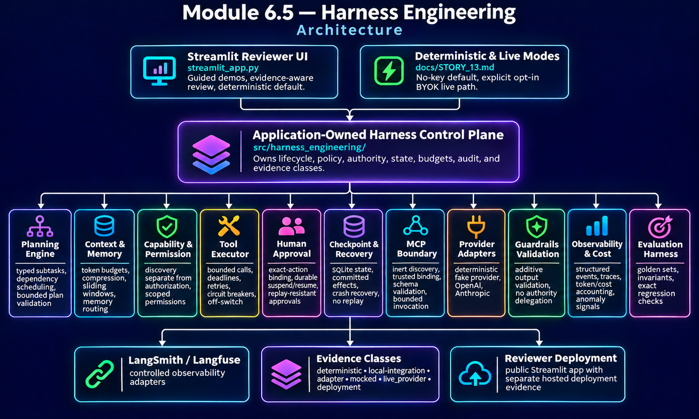

# Module 6.5 — Harness Engineering


A production-grade agent harness that keeps planning, context, memory, capability authorization, execution, recovery, human approval, MCP integration, observability, evaluation, cost governance, safety, and provider execution under application-owned control.

## Executive Summary

**What.** Module 6.5 is a governed agent-runtime harness that controls the full lifecycle of an AI-agent workflow: task decomposition, dependency scheduling, bounded context construction, capability selection and authorization, execution, checkpointing, recovery, human approval, MCP integration, observability, evaluation, cost governance, and safe termination.

**How.** A finite LangGraph lifecycle sits behind typed application-owned policy and state. Planning, context, memory, permissions, tool execution, durable SQLite recovery, exact-action human approval, MCP binding, provider adapters, guardrails, telemetry, cost accounting, regression evaluation, and Streamlit presentation remain separated behind explicit trust and authority boundaries.

**Why.** Reliable agents need more than prompts and tools. They need deterministic authority, bounded execution, resumable state, replay protection, independent approval, evidence provenance, cost and latency controls, adversarial failure handling, and a reviewer-visible way to distinguish deterministic, adapter, live-provider, and deployment evidence.

**Proof.** The accepted implementation closes all **69 of 69 approved requirements**, **6 of 6 hands-on labs**, **5 of 5 required deliverables**, and **9 of 9 named technology roles**. The final module suite records **2,063 passing tests** plus Ruff and compileall, independently accepted bounded live-provider evidence for OpenAI and Anthropic, verified hosted Streamlit deployment, controlled publication to main, and completed recruiter-facing LinkedIn closeout.

---

## Start Here / Reviewer Path

### Public reviewer path

Start with the [User Guide](docs/USER_GUIDE.md) for guided walkthroughs, expected results, failure exercises, and evidence interpretation.

Then open the deployed Streamlit reviewer application:

**https://dm-aiep-agent-engineering-module-06-5.streamlit.app/**

Recommended review order:

1. **Reviewer guidance** — understand the evidence classes, trust boundaries, safety posture, and deployment limits.
2. **Planning and context** — inspect deterministic task planning, dependency scheduling, context budgets, compression, and memory routing.
3. **Permissions and execution** — verify that capability selection never grants authority and that bounded execution is independently authorized.
4. **Recovery and HITL** — review durable checkpoints, no-replay recovery, exact-action approval binding, suspension, resume, denial, and audit behavior.
5. **MCP and providers** — inspect inert discovery, trusted MCP binding, provider-neutral adapters, deterministic defaults, and explicit opt-in live execution.
6. **Observability and evaluation** — review structured events, cost/latency governance, regression checks, and evidence classification.


### Reviewer posture

The public reviewer experience is designed to be useful without credentials. Deterministic/no-key operation is the default. Live provider use is explicit opt-in, bounded, separately authorized, and classified independently from accepted live-provider evidence.

Credential presence grants connectivity only. It never grants application authority.

---

## Key Capabilities

| Capability | Evidence / reviewer surface |
| --- | --- |
| Task planning and dependency scheduling | Typed decomposition, dependency validation, deterministic priority ordering, cycle and malformed-plan rejection |
| Context and memory orchestration | Dynamic prompt construction, token budgeting, summarization compression, sliding windows, bounded memory routing |
| Capability and permission control | Discovery separated from deterministic authorization; scoped permissions, blocklists, approval-required metadata |
| Bounded execution | Deadlines, retry limits, exponential backoff, circuit breaking, graceful degradation, hard stops, off-switch |
| Durable recovery | SQLite checkpoints, committed-effect tracking, crash recovery, idempotent re-entry, no replay of committed effects |
| Human approval | Confidence-triggered suspension, independent approver authority, exact-action/version binding, durable audit, replay rejection |
| MCP integration | Inert discovery, trusted binding, schema validation, bounded invocation, explicit authorization, local SDK integration |
| Provider abstraction | Deterministic fake provider plus optional OpenAI and Anthropic adapters behind one application-owned contract |
| Guardrail validation | Additive Guardrails AI output validation without delegating authority to the validation framework |
| Observability and cost governance | Structured events, trace correlation, advisory anomaly signals, token/cost accounting, spend thresholds, latency cohorts |
| Evaluation and regression | Inline invariants, bounded golden sets, exact-comparison regression harness, fail-closed drift detection |
| Reviewer experience | Guided Streamlit demonstrations with explicit action, expected result, evidence class, and limitation labels |

### Evidence classes

Module 6.5 deliberately keeps evidence classes separate:

- `deterministic`
- `local-integration`
- `adapter`
- `mocked`
- `live_provider`
- `deployment`

A lower evidence class is never promoted merely because an adapter exists, a credential is present, a test passes, or a hosted application starts.

---

## Architecture



The application—not the model, provider, memory system, MCP server, tool, or orchestration framework—owns authority.

The principal control flow is:

**Task intake → planning → bounded context → capability routing → authorization → optional human approval → bounded execution → result validation → checkpoint / telemetry → next work or safe completion.**

Core architectural responsibilities include:

- **Harness Service** — application-owned lifecycle, budgets, cancellation, execution status, and recovery.
- **Planning Engine** — typed subtasks, dependencies, priorities, bounded plan validation.
- **LangGraph Runtime** — finite lifecycle orchestration with explicit counters and stop conditions.
- **Context / Memory Boundary** — token budgets, compression, sliding windows, trust-preserving memory routing.
- **Capability / Permission Boundary** — metadata discovery separated from deterministic authorization.
- **Tool Executor** — bounded application-level execution; not represented as OS/container isolation.
- **MCP Boundary** — discovery, trusted binding, validation, authorization, bounded invocation, and audit.
- **Checkpoint / Recovery Store** — SQLite-backed state, approvals, effects, recovery metadata, and idempotent re-entry.
- **Human Approval Service** — durable asynchronous approval state bound to the exact pending action.
- **Provider Boundary** — deterministic default with optional OpenAI and Anthropic adapters.
- **Guardrail Boundary** — additive output validation that cannot authorize behavior.
- **Observability / Cost Boundary** — events, traces, anomaly signals, token usage, cost attribution, spend controls, latency evidence.
- **Evaluation Harness** — invariant checks, golden-set execution, regression comparison, and reviewer-visible evidence.
- **Streamlit UI** — presentation only; no authoritative domain policy.

---

## Technology Stack

| Area | Technology |
| --- | --- |
| Language | Python 3.12 |
| Validation / contracts | Pydantic |
| Lifecycle orchestration | LangGraph |
| Persistence | SQLite / standard-library `sqlite3` |
| MCP integration | MCP SDK |
| Long-term memory boundary | Mem0 adapter |
| Provider adapters | OpenAI SDK, Anthropic SDK |
| Output validation | Guardrails AI |
| Observability adapters | LangSmith, Langfuse |
| Gateway boundary | Helicone disabled/offline contract |
| Reviewer UI | Streamlit |
| Quality | Ruff, pytest, compileall |
| Packaging / execution | `uv` |

Only LangGraph and the MCP SDK sit on the source-faithful critical runtime path. The remaining named technologies are optional adapters or bounded integration surfaces with explicitly classified evidence.

---

## Production-Grade Engineering

### Application-owned authority

Models and integrations provide capabilities, not authority. Application policy owns:

- workflow state and routing;
- capability authorization;
- approval requirements;
- retry and fallback eligibility;
- budgets and deadlines;
- cost admission;
- evidence classification;
- cancellation and safe stop behavior.

### Bounded execution

Loops, retries, calls, context, outputs, cost, latency, and workflow lifetime are explicitly bounded. Authorization, safety, budget, human-denial, and validation failures terminate without being silently retried into success.

### Recovery without replay

Checkpoint restoration revalidates current trusted policy, approvals, committed effects, and state compatibility before resume. Successfully committed effects are not replayed after recovery.

### Human-in-the-loop approval

Approval is durable application state rather than transient UI state. Requesters cannot self-approve where independent approval is required. Stale, forged, replayed, consumed, mismatched, or unauthorized approvals fail closed.

### Dual-mode provider execution

Deterministic/no-key reviewer mode is the default. Live OpenAI or Anthropic execution requires explicit activation, an allowlisted provider/model, approved credential delivery, explicit charge acknowledgement where applicable, fresh human authorization, fixed application-owned bounds, and a cost ceiling.

BYOK credentials are session-scoped and are not persisted by application code. Streamlit framework memory may retain widget values according to its own session/rerun lifecycle; the project does not overclaim immediate cryptographic erasure.

---

## Security and Trust Boundaries

The tested security posture includes:

- model, provider, tool, MCP, memory, retrieval, and user text treated as untrusted data;
- model output unable to self-authorize privileged behavior;
- tool discovery and selection separated from permission;
- prompt-injection content unable to expand application authority merely by containing instructions;
- exact-action/version approval binding;
- requester/approver separation where required;
- bounded retries, calls, time, tokens, outputs, and cost;
- off-switch checks before consequential execution boundaries;
- durable audit and recovery evidence;
- credential redaction and non-persistence by application code;
- deterministic public/reviewer paths requiring no paid provider execution.

These controls do **not** claim universal prompt-injection immunity, production identity/authentication, formal security certification, hostile-file sandboxing, or OS/container isolation.

---

## Testing and Verification

Final accepted Module 6.5 verification includes:

- **69 / 69 approved requirements** closed;
- **6 / 6 source labs** implemented and reviewer-demonstrable;
- **5 / 5 required deliverables** implemented and verified;
- **9 / 9 named technologies** represented with truthful roles and evidence classifications;
- **2,063 automated tests passing** on the accepted final-integration candidate;
- Ruff PASS;
- compileall PASS;
- independent review and adversarial acceptance;
- controlled integration and publication to `main`.

### Bounded live-provider evidence

One independently accepted, human-authorized bounded exercise succeeded for each supported live provider:

| Provider | Model | Attempts | Retries | Classification |
| --- | --- | ---: | ---: | --- |
| OpenAI | `gpt-6-luna` | 1 | 0 | `live_provider` |
| Anthropic | `claude-haiku-5-5` | 1 | 0 | `live_provider` |

Those exercises establish the reviewed live path for those providers and models only. They do not establish provider SLA, universal model support, billing certification, deployment validation, scale readiness, or provider-level production readiness.

### Hosted deployment evidence

The public Streamlit deployment was separately verified. It started successfully with the locked OpenAI, Anthropic, and MCP dependencies available, and one explicitly authorized bounded OpenAI BYOK call completed through the governed path.

That hosted BYOK call remains **`adapter`-class evidence inside a separate `deployment` record**. It does not create or replace `live_provider` evidence. Anthropic was not exercised through the hosted application.

---

## Run Locally

From the module directory:

```powershell
streamlit run streamlit_app.py
```

The normal reviewer path is deterministic and credential-free.

Use synthetic, non-sensitive data when exploring demonstrations.

---

## Documentation / Deep Dives

- [User Guide](docs/USER_GUIDE.md) — reviewer walkthrough, expected outcomes, failure exercises, evidence interpretation, and troubleshooting
- [Authoritative Source](docs/AUTHORITATIVE_SOURCE.md) — course-source transcription and scope
- [Architecture](docs/ARCHITECTURE.md) — frozen system architecture and invariants
- [Traceability](docs/TRACEABILITY.md) — requirement-to-implementation closure and evidence mapping
- [Release Readiness](docs/RELEASE_READINESS.md) — engineering acceptance chronology, evidence classes, and release non-claims
- [Story 13](docs/STORY_13.md) — secure dual-mode provider completion, live-provider chronology, BYOK, and hosted deployment evidence
- [Implementation Plan](docs/IMPLEMENTATION_PLAN.md) — accepted story sequence
- [Portfolio README](../README.md) — Repo 2 engineering progression
- Source: [`src/harness_engineering/`](src/harness_engineering/) · [`streamlit_app.py`](streamlit_app.py) · [`tests/`](tests/)

Historical story records under `docs/` preserve the chronology at the time each slice was authored. For current module completion status, use this README together with the root portfolio README and the final accepted publication state.

---

## Evidence and Limitations

| Area | Established evidence | Not established |
| --- | --- | --- |
| LangGraph | Genuine finite typed lifecycle orchestration | Hosted LangGraph service or autonomous authority |
| MCP | Genuine SDK integration with inert discovery, trusted binding, bounded invocation, and local transport evidence | Public authenticated production MCP service |
| Recovery | SQLite checkpointing, committed-effect tracking, crash recovery, idempotent re-entry | Power-loss durability or distributed transactional recovery |
| HITL | Durable application-owned approval lifecycle with exact-action binding and adversarial replay/staleness rejection | Production identity/authentication |
| OpenAI | Adapter verification plus one independently accepted bounded live-provider run; separate hosted adapter-class BYOK call | Provider SLA, universal model validation, billing certification, provider-level production readiness |
| Anthropic | Adapter verification plus one independently accepted bounded live-provider run | Hosted Anthropic execution, SLA, universal model validation, provider-level production readiness |
| Guardrails AI | Genuine bounded validation adapter | Sole security boundary or hosted validation service |
| Mem0 | Tested optional memory adapter seam | Live hosted Mem0 service |
| LangSmith / Langfuse | Genuine SDK activity over controlled offline boundaries | Hosted service verification |
| Helicone | Strict disabled configuration/header boundary | Live routing or provider gateway use |
| Streamlit deployment | Verified reviewer-facing hosted application | General production deployment, capacity, SLA, or unlimited scale |
| Latency / cost | Local latency cohorts, deterministic fixture accounting, bounded accepted live-call exposure | Production latency certification or general billing accuracy |

Additional boundaries:

- the application-level sandbox is not OS/container isolation;
- approval identities in demonstrations are simulated fixtures;
- external evidence artifacts are referenced by digest and grant no runtime authority;
- deterministic reviewer workflows require no paid inference;
- provider credentials grant connectivity only and never authority;
- hosted deployment verification and accepted live-provider evidence remain separate evidence classes.

Module 6.5 is **complete and published**. Engineering acceptance, deployment verification, final documentation reconciliation, controlled main publication, and recruiter-facing LinkedIn closeout are complete.

For the broader progression from harness engineering through reliability, MCP infrastructure, multimodal systems, and production deployment, see the [Repo 2 portfolio README](../README.md).

---

Developed from Techademy AI Engineering Program requirements, with independent architecture, implementation, production-grade engineering enhancements, security hardening, testing, deployment verification, and reviewer-facing evidence.
