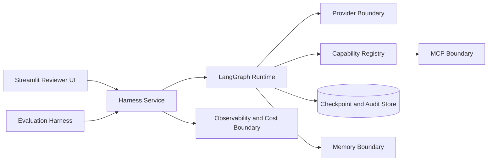
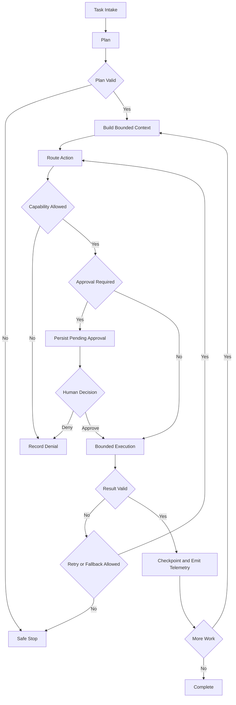

# Module 6.5 Architecture

## Status

**APPROVED AND FROZEN - HUMAN APPROVAL EFFECTIVE 2026-10-11**

This proposal implements the approved Module 6.5 baseline of 62 source-derived requirements plus 7 additive engineering requirements, for 69 total requirements.

## Architectural Goal

Build an application-owned production-grade agent harness that controls planning, context, memory, capabilities, execution, recovery, human approval, MCP integration, observability, evaluation, cost governance, and safety.

Frameworks, models, tools, memories, and external systems provide bounded capabilities. They do not own application authority.

## System Context

## Core Components

### Harness Service

Application-owned control plane for task intake, lifecycle policy, budgets, authority, cancellation, workflow execution, status, and recovery.

### Planning and Dependency Engine

Produces typed executable subtasks with identifiers, dependencies, priorities, status, and bounded execution metadata. Ready subtasks enter a deterministic priority queue only after their dependencies are satisfied; stable tie-breaking preserves reproducible ordering. Deterministic validation rejects malformed plans, missing dependencies, cycles, unsupported actions, and plans exceeding configured limits.

### LangGraph Execution Runtime

LangGraph is the proposed core orchestration framework. Typed graph state and finite routing coordinate planning, validation, context construction, authorization, approval interruption, execution, result validation, checkpointing, fallback, and termination.

All loops have explicit counters and stop conditions. Model output cannot directly select arbitrary privileged graph transitions.

### Context Manager

Owns dynamic prompt construction, token budgeting, relevance selection, summarization compression, and sliding-window behavior. Context retains provenance and trust classification.

### Memory Boundary

Short-term working memory remains in typed execution state. A deterministic memory router decides whether bounded information remains short-term, is eligible for long-term storage, or may be retrieved into a later context. Mem0 is an optional long-term semantic-memory adapter. Retrieved memory remains untrusted contextual data and cannot own authority, approval, checkpointing, or recovery.

### Capability and Permission Registry

Every executable capability has identity, schema, risk classification, scope, approval policy, timeout, and resource limits. Tool selection and authorization are separate operations. Deterministic policy alone grants execution authority.

### Sandboxed Tool Executor

Authorized demonstration tools receive only explicit inputs and capabilities, bounded runtime and output, and dedicated temporary storage when needed. The project claims only the isolation actually demonstrated by tests.

### MCP Boundary

MCP SDK provides capability registration, discovery, schema validation, allowlisting, permission evaluation, bounded invocation, output validation, and audit capture. Discovery never implies trust or authorization.

### Checkpoint and Recovery Store

Application-owned persistence contracts store checkpoints, approval records, audit events, and recovery metadata. SQLite is proposed for the deterministic local implementation.

Checkpoints record workflow identity, state version, completed work, pending work, budgets, retry state, approvals, and idempotency information.

### Human Approval Service

Approval is durable workflow state rather than transient UI state. A workflow may suspend while approval is pending and resume asynchronously after an authorized human decision. Decisions bind to the exact pending action and record requester, risk, confidence threshold or escalation reason, evidence, decision, override information, and audit history.

### Provider Boundary

A narrow application-owned provider protocol isolates model vendors. A deterministic fake provider supports normal tests and demonstrations. OpenAI SDK and Anthropic SDK are optional live-provider adapters.

### Guardrail Boundary

Guardrails AI is an additional model-output validation adapter. Deterministic capability scope, authorization, blocklists, HITL, budgets, and stop conditions remain the security perimeter.

### Observability and Cost Boundary

Provider-neutral structured events and correlation identifiers capture workflow, step, model, tool, MCP, approval, recovery, retry, token, latency, and cost activity. Distributed-tracing hooks propagate bounded trace context across supported execution boundaries. Cost governance attributes usage to workflow and step, evaluates configured spend thresholds, emits reviewer-visible spend alerts before or when limits are reached, and blocks further billable execution when a hard budget is exhausted. LangSmith, Langfuse, and Helicone are optional integrations rather than runtime correctness dependencies.

### Evaluation and Regression Harness

A deterministic golden-set harness verifies planning, dependency ordering, context budgets, compression, permission denial, MCP validation, retries, circuit breaking, fallback, hard stops, recovery, idempotency, approval, cost controls, output validation, and the off-switch. Inline deterministic assertions check critical workflow invariants at execution boundaries, and regression suites compare current behavior with retained golden expectations.

### Streamlit Reviewer UI

Streamlit is the presentation layer and contains no authoritative domain policy. Guided demonstrations cover planning, context compression, permissions, recovery, HITL, MCP, traces, cost governance, regression results, safety denials, and the off-switch.

Every major workflow explains what action to take, what result to expect, and what engineering property the result demonstrates.

## Execution Flow

## Recovery Model

Recovery loads a checkpoint by workflow identity, validates schema and state version, reconstructs bounded state, verifies approvals and committed effects, rejects ambiguous re-entry, and resumes from the first safe incomplete boundary.

Crash-recovery tests verify that committed effects are not replayed.

## Retry, Fallback, and Circuit-Breaker Model

Retries are bounded by attempts, elapsed time, and remaining budgets. Transient failures may use exponential backoff. Authorization, validation, budget, safety, and human-denial failures terminate without retry.

Repeated provider or tool failures update circuit-breaker state. Fallback cannot bypass authorization, approval, cost, or safety controls.

## Proposed Default Budgets

| Control | Proposed default |
| --- | --- |
| Maximum plan steps | 12 |
| Maximum retries per action | 2 |
| Maximum provider attempts per workflow | 8 |
| Maximum tool or MCP calls per workflow | 12 |
| Maximum context budget | 12000 tokens |
| Maximum output budget per provider call | 2000 tokens |
| Default action timeout | 30 seconds |
| Default workflow deadline | 180 seconds |
| Deterministic/local workflow latency SLO | p95 <= 5 seconds |
| Live monetary budget | Disabled unless explicitly configured |

The deterministic test and normal reviewer paths incur no model-provider spend.

The evaluation harness measures deterministic/local end-to-end workflow latency across regression runs and reports p50 and p95 latency against the configured p95 latency SLO. The workflow deadline remains a separate hard safety bound rather than a performance target.

## Approval Policy

Deterministic policy requires approval for consequential actions, privileged capability scope, configured risk or confidence thresholds, and policy-defined escalation states. A model cannot decide that its own privileged action does not require approval.

## Safety Model

Safety layers include typed inputs, plan validation, untrusted-data separation, capability allowlisting, deterministic permissions, blocklists, approval gates, bounded execution, output validation, retry limits, resource limits, cost limits, latency limits, audit evidence, and an application-owned off-switch.

Prompt injection is treated as an untrusted-input attack. Retrieved, memory, MCP, tool, and model content cannot alter application authority merely by containing instructions.

## Off-Switch Protocol

Cancellation state is application-owned and checked before consequential execution boundaries. Activation denies new privileged actions, safely stops pending work, records cancellation, and requires policy-compliant re-entry before resume.

## Anomaly Detection

Local structured telemetry detects retry bursts, denial bursts, budget spikes, repeated provider failures, excessive compression, and unusual tool-call frequency without requiring a hosted anomaly service.

## Named Technology Classification

| Technology | Proposed role | Deterministic core |
| --- | --- | --- |
| LangGraph | Core orchestration | Yes |
| Mem0 | Long-term memory adapter | No |
| MCP SDK | External capability integration | Yes |
| LangSmith | Observability adapter | No |
| Langfuse | Observability and cost adapter | No |
| Guardrails AI | Validation adapter | No |
| Helicone | Gateway observability integration | No |
| OpenAI SDK | Live provider adapter | No |
| Anthropic SDK | Live provider adapter | No |

## Source Lab Mapping

| Source lab | Architectural owner |
| --- | --- |
| Task planning with decomposition and dependency tracking | Planning Engine and LangGraph Runtime |
| Context compression with token-budget enforcement | Context Manager |
| Tool-permission registry with sandboxed execution | Capability Registry and Tool Executor |
| Checkpointed agent with crash recovery and resume | Checkpoint and Recovery Store |
| Human approval with asynchronous escalation | Human Approval Service |
| Trace capture, structured logging, and cost dashboard | Observability Boundary and Streamlit UI |

## Deliverable Mapping

| Source deliverable | Architectural owner |
| --- | --- |
| Harness-engineered agent runtime with full lifecycle control | Harness Service and LangGraph Runtime |
| Checkpointing and recovery system | Checkpoint and Recovery Store |
| Human-in-the-loop approval workflow | Human Approval Service |
| Observability and cost governance dashboard | Observability Boundary and Streamlit UI |
| Regression test harness for agent behaviour | Evaluation and Regression Harness |

## Dependency Strategy

Python 3.12 is the proposed runtime baseline.

Local uv evidence verified a combined 141-package resolution containing LangGraph 1.2.14, Mem0 2.2.1, MCP 2.3.0, LangSmith 0.14.7, Langfuse 4.17.0, Guardrails AI 0.11.0, OpenAI 2.54.0, and Anthropic 1.13.0.

Compatibility does not imply that every integration becomes a mandatory dependency. Core and optional dependency groups remain separate where practical.

## Package Boundaries

The implementation preserves responsibilities equivalent to domain, planning, context, memory, capabilities, orchestration, persistence, approvals, providers, MCP, guardrails, observability, evaluation, and UI packages.

Exact filenames may evolve without changing approved responsibilities.

## Evidence Model

Claims distinguish deterministic, mocked, adapter, local-integration, live-provider, and deployment evidence. Lower evidence classes must never be presented as higher ones.

## Architecture Invariants

- Application policy owns authority.
- External and generated data remains untrusted until validated.
- Model output cannot self-authorize privileged behavior.
- Tool selection is separate from tool permission.
- Approval is durable and auditable.
- Recovery is idempotent.
- Retries and loops are bounded.
- Deterministic tests require no paid calls.
- Observability vendors are not prerequisites for runtime correctness.
- Cost and latency are explicit runtime budgets.
- Retry and fallback cannot bypass safety or authority.
- UI contains no authoritative domain policy.
- Module 6.5 remains standalone.

## Human Approval Gate

This architecture remains PROPOSED. Implementation and architecture freeze require explicit human approval.
