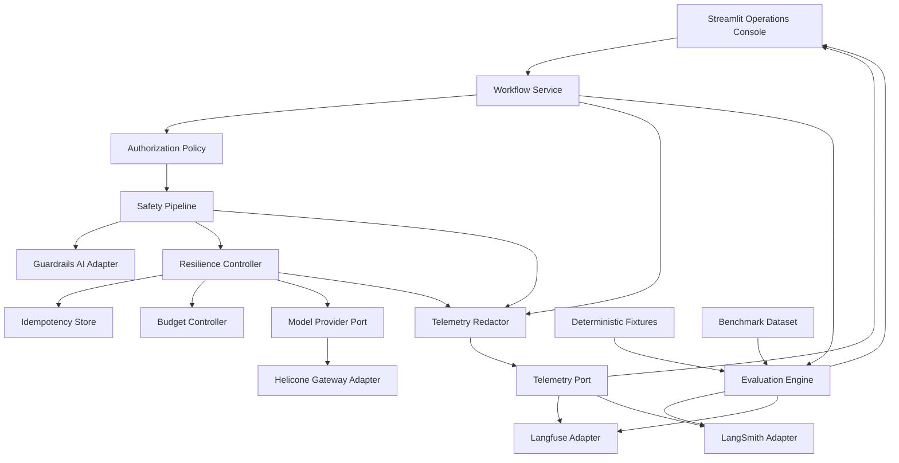

# Module 7 - Architecture

## Status

APPROVED / FROZEN - Human-approved architecture, 2026-10-11.

This architecture and its ADRs are human-approved and frozen. Implementation shall conform to this contract unless an explicitly approved architecture change supersedes it.

## Architectural Goal

Deliver a standalone reliability, safety, observability, and evaluation system in which application-owned controls preserve correctness and authority while course-indicated technologies provide meaningful specialist capabilities and verifiable evidence.

## Core Design Principle

Core correctness, authorization, resilience, idempotency, budgets, and recovery are application-owned.

Vendor systems may observe, evaluate, validate, proxy, or transport execution, but vendor output shall not directly grant application authority or become necessary for deterministic core correctness.

## Logical Architecture

## Execution Flow

1. Streamlit submits a bounded workflow request.
2. The workflow service establishes request identity, trace identity, idempotency identity, and execution budget.
3. Authorization policy determines which application tools/actions are permitted.
4. The safety pipeline validates untrusted input without granting authority.
5. The resilience controller executes the permitted operation with timeout, retryability classification, bounded retries, fallback, budget checks, and idempotency protection.
6. Model-provider traffic may pass through the Helicone adapter when live gateway evidence is enabled.
7. Operational events are redacted before crossing telemetry-provider boundaries.
8. Langfuse receives primary operational tracing/latency/cost evidence.
9. LangSmith receives independent evaluation/regression evidence and may receive selected traces required for meaningful integration.
10. The evaluation engine runs deterministic benchmarks by default and bounded live/model-backed evaluations only when explicitly enabled.
11. Streamlit presents normalized operational and evaluation evidence plus links or identifiers for specialist vendor views when available.

## Application-Owned Control Plane

### Authorization

Authorization is explicit application policy.
Model output, Guardrails results, telemetry, retrieved text, and vendor responses cannot elevate permissions.
Denied operations fail closed and emit redacted decision evidence.

### Safety

Safety is layered:

- deterministic input checks
- Guardrails AI validation
- prompt-injection containment
- moderation policy
- output validation

Safety validation can allow, reject, sanitize, or request bounded fallback behavior according to policy, but cannot grant tool authority.

### Reliability

The resilience controller owns:

- retryability classification
- bounded retry count
- exponential/backoff policy where appropriate
- timeout enforcement
- fallback selection
- idempotency checks
- recovery state
- budget enforcement

Fallback never bypasses authorization or safety.

### Cost Governance

Every potentially billable execution carries a bounded execution budget.
Retries and evaluations consume that budget.
Budget exhaustion fails safely and is observable.

## Observability Architecture

The application emits a normalized internal telemetry model before vendor adaptation.

Minimum event fields include:

- trace_id
- span_id
- workflow_id
- operation
- status
- start/end or duration
- retry_attempt
- fallback_used
- safety_decision
- authorization_decision
- token/usage data when available
- normalized cost when available
- error classification
- evidence_class

Secrets and prohibited content are removed before external telemetry export.

### Langfuse Responsibility

Langfuse is the primary course-tool integration for operational workflow observability:

- traces
- spans/observations
- latency
- usage/cost
- workflow debugging
- selected evaluation scores

Core workflow success does not depend on Langfuse availability.

### LangSmith Responsibility

LangSmith is the primary course-tool integration for independent evaluation evidence:

- datasets/examples where live integration is exercised
- automated evaluation
- regression comparison
- benchmark evidence
- selected tracing sufficient to demonstrate meaningful integration

Ordinary CI does not require LangSmith credentials.

### Helicone Responsibility

Helicone provides gateway-level evidence:

- model request observability
- latency
- usage/cost evidence
- gateway routing/fallback evidence where exercised

Helicone is accessed through an adapter boundary so deterministic core tests do not depend on a live gateway.

Application-owned fallback remains authoritative even if gateway fallback is demonstrated.

## Evaluation Architecture

The evaluation engine has two execution modes.

### Deterministic Mode

Default for CI and ordinary development:

- controlled benchmark fixtures
- deterministic evaluators
- regression thresholds
- failure/recovery scenarios
- safety and authorization scenarios
- no vendor credentials required
- no billable model calls required

### Live Evidence Mode

Explicitly enabled and bounded:

- real course-tool integrations
- optional model-backed evaluators
- vendor trace/evaluation identifiers
- explicit cost and call limits
- evidence labeled live

Live mode is evidence generation, not a prerequisite for ordinary unit/integration CI.

## Continuous Improvement Loop

Benchmark and regression results produce versioned evaluation evidence.
A failing regression identifies the affected scenario and metric.
Repairs are made through normal engineering workflow.
The same benchmark is rerun before improvement is claimed.

The system does not autonomously modify production policy or code from evaluation output.

## Failure-Recovery Architecture

A deterministic failure injector supports controlled scenarios:

- transient provider failure
- permanent provider failure
- timeout
- telemetry-provider failure
- guardrail rejection/failure
- authorization denial
- duplicate/replayed request
- malformed provider response
- budget exhaustion

Failure injection is confined to test/demo boundaries and cannot silently activate in normal execution.

## State Model

The minimum workflow state contains:

- workflow identity
- trace identity
- idempotency key
- current operation
- authorization decision
- safety decision
- attempt count
- fallback state
- budget state
- normalized usage/cost
- terminal status
- evidence classification

The initial architecture uses bounded in-process state and an application-owned idempotency abstraction.
Persistent distributed state is not required by the source and shall not be introduced unless implementation evidence establishes a need.

## Trust Boundaries

Trusted:

- committed policy
- validated application configuration
- application authorization logic

Untrusted until validated:

- user input
- model output
- external/provider responses
- tool arguments derived from untrusted content
- tool results
- telemetry-provider responses
- evaluation content

Secrets are privileged data and never become model or telemetry content.

## Provider Failure Semantics

Observability-provider failure:
- core workflow may continue if policy permits
- local telemetry records provider-export failure
- no authority changes

Evaluation-provider failure:
- live evaluation is marked failed/unavailable
- deterministic evaluation remains independent

Guardrail failure:
- safety-sensitive operation fails closed unless an explicitly approved deterministic safety fallback exists

Helicone failure:
- deterministic/local workflow paths remain testable
- live gateway execution reports failure rather than silently claiming fallback evidence

## Dependency Strategy

Use the smallest dependency set required by approved responsibilities.
Dependency versions are constrained and compatibility-tested.
guardrails-ai==0.10.1 is prohibited.
No dependency is added merely because it appears in an example or tutorial.

## Streamlit Architecture

Streamlit remains the reviewer-facing UI.

The UI should provide:

- concise usage guidance
- workflow execution controls
- deterministic/live mode labeling
- failure-scenario selection
- trace summary
- retry/fallback/recovery evidence
- safety and authorization decisions
- latency and usage/cost summary
- evaluation execution
- benchmark/regression results
- evidence classification

Credentials are never entered into or displayed by the Streamlit UI.

## Testing Architecture

Test layers:

1. Unit tests for policy, retryability, idempotency, budgets, redaction, evaluators, and adapters.
2. Integration tests using deterministic fake providers and telemetry sinks.
3. Adversarial tests for prompt injection, forged authority, permission bypass, telemetry leakage, replay, and malformed inputs.
4. Failure-recovery tests using controlled injection.
5. UI tests for reviewer-visible behavior and guidance.
6. Optional bounded live integration tests for course-tool evidence.

Formal gate:

Ruff -> pytest -> compileall

## Evidence Model

Every captured result is classified as one of:

- deterministic_fixture
- simulated_failure
- mocked_provider_contract
- live_vendor
- live_model

Claims must not exceed their evidence class.

## Deployment Posture

The module must run locally without live vendor credentials in deterministic mode.
Live integrations are enabled through environment configuration and secret injection.
Deployment topology remains intentionally lightweight because the source requires demonstrable engineering behavior rather than distributed production infrastructure.

## Requirement Closure

The observability platform demonstrates reliability, safety, workflow telemetry, debugging, latency, cost, and recovery evidence.

The evaluation pipeline demonstrates automated evaluation, regression testing, benchmarking, and continuous-improvement evidence.

Together they exercise the three labs and meaningful use of LangSmith, Langfuse, Helicone, and Guardrails AI.

## Implementation Story Contract

Implementation shall proceed through small, bounded stories after architecture approval.

Before implementation begins, each story shall identify:

- the frozen requirement IDs it satisfies
- the approved ADRs it implements or depends upon
- the intended implementation scope
- explicit acceptance criteria
- required automated tests
- required adversarial or failure-path tests where applicable
- expected evidence class
- reviewer-visible evidence where applicable

A story shall not silently introduce a consequential architectural decision.

If implementation reveals a genuine architectural defect or requirement conflict, work shall stop at that boundary and route the decision through the established human approval process.

## Independent Review Contract

Implementation completion and acceptance are separate events.

An implementation story is not accepted solely because its implementing agent, developer, or automation reports success.

Before acceptance, the story shall undergo independent verification against:

- its acceptance criteria
- applicable frozen requirements
- applicable approved ADRs
- expected security and authority boundaries
- expected failure behavior
- required tests
- claimed evidence

Independent review shall not weaken requirements, architecture, tests, security controls, or quality gates to obtain acceptance.

## Bounded Self-Healing Contract

Automated repair is permitted only inside explicit bounded repair loops.

The repair sequence is:

1. Capture the exact failing quality-gate diagnostic.
2. Classify the failure.
3. Apply deterministic safe repair when available.
4. Rerun the failed gate.
5. If necessary, perform a bounded semantic repair using the exact diagnostic and relevant implementation/test context.
6. Rerun the failed gate.
7. After the failed gate passes, rerun the complete fail-fast quality-gate sequence.
8. Escalate when the maximum repair-attempt count is reached or when repair requires a genuine design, requirement, authority, or risk decision.

Safe Ruff auto-fixes may be used where appropriate.
Unsafe fixes shall never be applied automatically.

Automated repair shall never:

- delete or weaken tests merely to obtain green status
- weaken validation or authorization
- disable security controls
- relax source requirements
- change approved architecture without authorization
- hide or reclassify a failure
- loop without a bounded attempt limit

A later passing gate cannot compensate for an earlier failed gate unless that failed gate was repaired and the complete gate sequence subsequently passed.

## Python Implementation Contract

Python implementation shall use type hints throughout public interfaces.

Modules, classes, public functions, and public methods shall use Google-style docstrings where appropriate.

Args, Returns, and Raises sections shall be included where applicable.

Boundary inputs shall be validated before they are trusted by downstream components.

Exception handling shall exist at real failure boundaries rather than through blanket defensive try/except blocks.

Expected exceptions shall produce specific and actionable errors.

Exception chaining shall preserve causal context where appropriate.

Blanket exception swallowing is prohibited.

Expected failure paths shall be covered by tests.

These standards are implementation contracts and do not authorize unnecessary abstraction or boilerplate.

## Configuration and Startup Contract

Runtime configuration shall be represented through typed, validated application configuration.

Configuration shall distinguish:

- deterministic local mode
- optional live integration mode
- non-secret runtime settings
- externally supplied credentials and secrets

Configuration validation shall occur before a workflow depends on the affected capability.

Missing or invalid security-critical configuration shall fail closed with an actionable error.

Missing optional live-provider credentials shall not prevent deterministic mode from starting.

Secrets shall be supplied externally and shall not be committed, displayed in Streamlit, included in benchmark fixtures, or emitted through telemetry.

Live integrations shall require explicit enablement rather than activating merely because credentials happen to exist.

Invalid evidence-mode configuration shall not silently downgrade or upgrade the evidence classification.

## Release and Evidence Authority

Release and completion claims are governed by verified evidence.

README content, Streamlit content, release notes, portfolio descriptions, documentation, and completion statements shall not claim behavior beyond what matching implementation and verification evidence demonstrates.

Live vendor capability claims require matching live_vendor evidence.

Live model behavior claims require matching live_model evidence.

Simulated failure evidence shall remain labeled simulated_failure.

Mocked provider-contract evidence shall remain labeled mocked_provider_contract.

Deterministic fixture evidence shall remain labeled deterministic_fixture.

Before release, final reconciliation shall verify:

- all frozen requirements
- all approved ADRs
- implementation-story acceptance
- automated tests
- adversarial and failure-path tests
- quality-gate results
- evidence classifications
- required live integration evidence
- documentation accuracy
- runnable deliverables
- guided Streamlit presentation

A passing test suite alone is insufficient to establish a live integration claim.

## Architecture-to-Implementation Traceability

The implementation plan shall preserve a traceable chain:

authoritative source -> frozen requirement -> approved ADR -> implementation story -> code -> test -> evidence -> deliverable -> release claim

Every source-derived requirement shall reach verified evidence before Module 7 is declared complete.

Every consequential implementation choice shall either conform to an approved ADR or be routed through architecture change control.

## Architecture Approval Boundary

This architecture is APPROVED AND FROZEN.
Human architecture approval was granted on 2026-10-11. Implementation may proceed through the approved story-based engineering workflow.
After approval, architecture is frozen and consequential structural changes require explicit justification and human approval.

