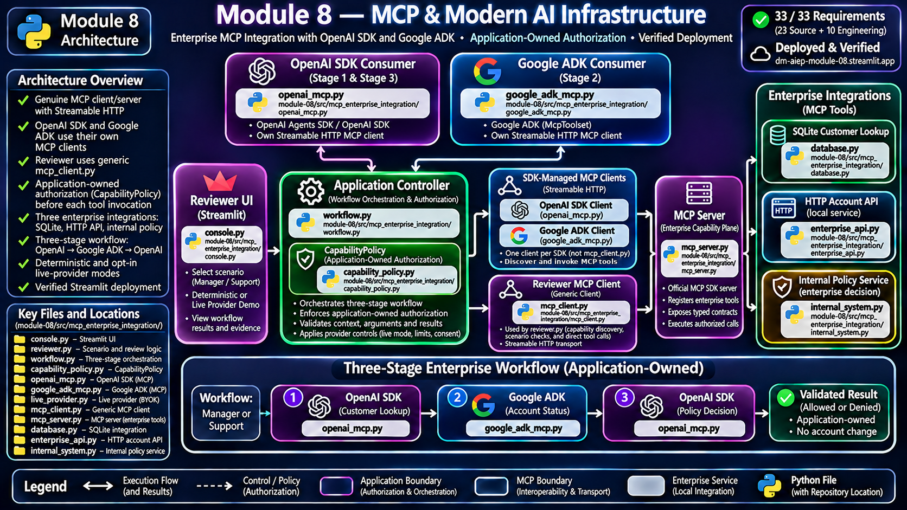

# Module 8 — MCP & Modern AI Infrastructure


A production-grade, standalone enterprise AI integration system demonstrating genuine MCP client/server interoperability, shared enterprise capabilities, independent application-owned authorization, and OpenAI SDK / Google ADK consumers.

## Executive Summary

**What.** Module 8 builds a vendor-neutral MCP enterprise capability plane exposing SQLite customer lookup, a local HTTP account API, and an internal policy service to heterogeneous AI SDK consumers.

**How.** An official MCP SDK server and Streamable HTTP clients connect OpenAI Agents SDK and Google ADK to the same capabilities. Typed context exchange, capability policy, strict validation, and bounded workflow execution remain application-owned. Streamlit displays real execution results without becoming the authority boundary.

**Why.** Enterprise interoperability should not depend on one model vendor or allow capability discovery, tool metadata, or agent output to grant privileges. MCP provides a reusable protocol boundary while application policy controls execution.

**Proof.** All **33 of 33 approved requirements** are traced: 23 source-derived and 10 additive engineering requirements. The accepted implementation demonstrates three enterprise integrations, three workflow stages, two deterministic reviewer scenarios, genuine Streamable HTTP transport, a verified Streamlit Cloud deployment, and a controlled OpenAI / Google ADK-Gemini live-provider exercise. The final recorded Story 11 repair gate passed **202 tests** with Ruff and compileall; recruiter-facing LinkedIn closeout is complete.

---

## Start Here / Reviewer Path

### Public reviewer path

Begin with the [User Guide](docs/USER_GUIDE.md) for scenario selection, expected outcomes, live-mode consent, evidence interpretation, and troubleshooting.

Then open the deployed [MCP Enterprise Infrastructure Console](https://dm-aiep-module-08.streamlit.app/).

Recommended review order:

1. **Orientation** — identify the MCP server, OpenAI SDK, Google ADK, enterprise capabilities, application policy, and evidence classes.
2. **Manager review** — inspect three discovered tools, the viewer capability denial, the authorized enterprise workflow, and the final internal-service allow business decision.
3. **Support review** — inspect the same viewer capability denial and the separate internal-service deny business decision. Support is authorized to invoke the policy tool; its business denial is not a CapabilityPolicy invocation denial.
4. **Transport and interoperability** — inspect Streamable HTTP, MCP discovery, schema/context exchange, SQLite results, local HTTP API results, and the internal policy service.
5. **Direct versus MCP** — compare direct repository lookup with the discoverable protocol-mediated capability; do not treat this as a performance benchmark.
6. **Provider modes** — inspect the deterministic default, separately consented live path, bounded accepted live evidence, and deployment limitations.

### Reviewer posture

The deterministic reviewer demonstration requires no API keys and makes zero provider-model calls. Manager and Support are fixed demonstration identities, **not real authentication**. Opt-in live/BYOK execution is a separate bounded path; credentials provide connectivity, never authorization.

---

## Key Capabilities

| Capability | Working reviewer evidence |
| --- | --- |
| MCP server and discovery | Official MCP SDK server, three registered enterprise tools, real client discovery, and typed schemas |
| Genuine transport | Streamable HTTP client/server sessions with negotiated protocol and transport evidence |
| Database connectivity | Parameterized SQLite customer lookup returning actual seeded local records |
| API orchestration | Bounded local HTTP account API with sanitized request and response evidence |
| Internal enterprise service | Callable policy evaluation returning a decision and rule without changing an account |
| SDK interoperability | OpenAI Agents SDK and Google ADK consume the same MCP enterprise capability plane |
| Application authority | Capability discovery separated from independent allowlist policy, exact arguments, validation, and denial |
| End-to-end workflow | OpenAI SDK → Google ADK → OpenAI SDK, with three validated stages and bounded context exchange |
| MCP versus direct calling | Runnable customer-lookup comparison explaining implementation coupling and protocol discovery |
| Deterministic reviewer scenarios | Manager allowed decision, Support denied decision, zero model calls in default mode |
| Opt-in live models | OpenAI and Gemini provider stages use application-authorized MCP tools under bounded consent |
| Reviewer deployment | Verified Streamlit Cloud console exposing actual backend execution and evidence classification |

### Evidence classes

Module 8 distinguishes deterministic, mocked, adapter, local-integration, live-provider, and deployment evidence. Genuine local MCP/HTTP execution is not automatically external provider execution; a configured SDK or injected model double does not establish live-provider evidence.

---

## Architecture



The **application-owned controller and CapabilityPolicy** retain authorization. MCP exposes capabilities and transport, while OpenAI SDK and Google ADK consume the same shared enterprise integration boundary. Streamlit is a reviewer presentation surface, not a security authority.

**Reviewer UI → Application Controller → application-owned capability authorization → OpenAI SDK / Google ADK consumers → their SDK-managed Streamable HTTP MCP connections → Enterprise MCP Server → SQLite / HTTP API / Internal Service → validated outputs and internal business-policy decision → Reviewer UI.**

Execution follows **discovery → schema validation → policy evaluation → authorization or denial → bounded invocation → output validation → evidence recording**. A model or tool cannot independently change the trusted role, bound capability, arguments, or final enterprise policy decision.

The architecture diagram is portfolio-facing; the [frozen architecture record](docs/ARCHITECTURE.md) remains the technical source for detailed boundaries and historical decisions.

---

## Technology Stack

| Area | Technology |
| --- | --- |
| Language and environment | Python 3.12, uv, locked module dependencies |
| Enterprise interoperability | Official MCP SDK; Streamable HTTP |
| First AI SDK consumer | OpenAI Agents SDK / OpenAI SDK |
| Second AI SDK consumer | Google ADK with McpToolset |
| Local data integration | SQLite |
| Local service integration | HTTP API and internal policy service |
| Reviewer UI | Streamlit |
| Quality gates | Ruff, pytest, compileall |

MCP is implemented and exercised. AI operating-system concepts and A2A are explained as complementary standards context; **this module does not implement an AI operating system or A2A transport**.

---

## Production-Grade Engineering

### Trust, policy, and authorization

The application independently authorizes capability use. Discovery cannot grant permission; untrusted model, MCP, API, and tool output cannot self-authorize. Provider-driven stages expose only the allowed capability and enforce exact application-bound tool arguments before dispatch.

### Bounded execution

Deterministic workflow and reviewer paths impose fixed execution deadlines and concurrency admission limits. Live mode separately bounds model calls, tool calls, tokens, retries, stage duration, run duration, and process admission. These controls are **not** billing or service-level guarantees.

### Credentials and live consent

Live mode requires explicit selection, provider enablement, masked per-run credentials, acknowledgement of external calls and potential charges, and deliberate execution. Environment and ambient Google credentials do not authorize model execution. The backend enforces provider policy independently of Streamlit controls.

### Application-owned outcome

The final internal policy stage remains deterministic and application-owned even when preceding OpenAI and Gemini stages use real models. Provider narratives are untrusted and cannot decide enterprise authorization.

---

## Security and Trust Boundaries

- Authorized consumer paths enforce application-owned CapabilityPolicy; raw MCP primitives are not a public authenticated authorization perimeter.
- Unknown roles, unauthorized capabilities, changed arguments, malformed context, and forged identity fields fail closed.
- Inputs and outputs are validated across MCP, SDK, database, API, and workflow boundaries.
- Provider keys are handled through a masked, bounded per-run path with redaction and consent controls; Python memory erasure is not guaranteed.
- Model text is display-only untrusted narrative, not an authority or identity source.
- Local reviewer services use loopback and must not be exposed to untrusted networks.
- Fixed Manager and Support scenarios are not production login identities.
- No general claim is made for network authentication, TLS, multi-host service security, formal compliance, provider SLA, production load, or guaranteed billing accuracy.

---

## Testing and Verification

The accepted requirements and local integration audit covered **23/23 source requirements and 10/10 engineering requirements**. The Story 10 fail-fast gate recorded **121 passing tests**; the Story 11 implementation gate recorded **196 passing tests**; the subsequent independent-review repair gate recorded **202 passing tests**, Ruff PASS, and compileall PASS. These are historical gate-specific counts, not a claim that a fresh full-suite run was performed during documentation normalization.

Real local verification covered MCP SDK discovery and Streamable HTTP, both AI SDK consumers, SQLite and HTTP services, application-policy denial, workflow validation, two Streamlit AppTest scenarios, failure paths, and credential-safe offline tests.

### Accepted live-provider exercise

The final deployed acceptance record reports **4 of 4 bounded model calls** completed across an authorized OpenAI stage and a Google ADK/Gemini stage. OpenAI exercised customer lookup; Gemini exercised account-status lookup through the shared MCP plane. Both provider-driven stages were classified as live-provider; the final enterprise policy stage remained local-integration with zero model calls.

The final README acceptance record does not establish a general provider/model support matrix, exact billing, continuous availability, or production provider readiness.

### Verified deployment

The [Streamlit Cloud deployment](https://dm-aiep-module-08.streamlit.app/) was rebooted and verified with genuine local enterprise execution, three discovered MCP capabilities, three workflow stages, and zero provider-model calls in the deterministic Manager demonstration. The deterministic Support demonstration was also accepted. The cloud environment used the module lockfile.

The deployment configuration uses GOOGLE_API_USE_CLIENT_CERTIFICATE=false to avoid an unnecessary Google mTLS credential probe during local MCP discovery. This does not disable application authorization or establish hosted enterprise-network readiness.

Historical Story 10/11 records retain earlier no-live/no-deployment statements reflecting their original review dates; the later final acceptance establishes the current completed state.

---

## Run Locally

Install Python 3.12 and uv, then run from the module-08 directory:

```powershell
uv sync --locked --extra dev
uv run streamlit run src/mcp_enterprise_integration/console.py
```

Choose Manager review or Support review and run the enterprise demonstration. The default path uses deterministic local integration, synthetic records, loopback services, and no paid model calls. Dependency installation may require network access.

For native verification, run Ruff, pytest, and compileall in that fail-fast order using the documented module environment.

---

## Documentation / Deep Dives

- [User Guide](docs/USER_GUIDE.md) — reviewer walkthrough, scenarios, evidence classes, live-mode boundaries, and troubleshooting
- [Authoritative Source](docs/AUTHORITATIVE_SOURCE.md) — course objective, topics, labs, tools, and deliverables
- [Requirements](docs/REQUIREMENTS.md) — 33 frozen requirements
- [Architecture](docs/ARCHITECTURE.md) — approved topology, trust boundaries, and additive live-mode design
- [Traceability](docs/TRACEABILITY.md) — requirement-to-implementation and verification mapping
- [Story 10](docs/stories/STORY-10-integrated-verification-release-evidence.md) — local audit, fail-fast gates, and deployment closeout
- [Story 11](docs/stories/STORY-11-opt-in-live-provider-byok.md) — provider integration, consent, bounded execution, evidence, and independent repair
- [Implementation Plan](docs/IMPLEMENTATION_PLAN.md) — accepted implementation sequence
- [Portfolio README](../README.md) — Repo 2 progression
- Source: [MCP integration package](src/mcp_enterprise_integration/) and [reviewer console](src/mcp_enterprise_integration/console.py)

---

## Evidence and Limitations

| Area | Established | Not established |
| --- | --- | --- |
| MCP | Genuine server/client, discovery, Streamable HTTP, schemas and bounded invocation | Authenticated public production MCP service |
| Enterprise systems | Real local SQLite, HTTP API and internal policy integration | External customer production traffic or enterprise network deployment |
| SDK interoperability | Shared MCP tools consumed through OpenAI SDK and Google ADK | A2A implementation or a general AI operating system |
| Authorization | Application-owned capability policy and fail-closed execution boundaries | Production user authentication or arbitrary remote-caller security |
| Deterministic UI | Verified Manager and Support paths with zero model calls | Live inference from the default reviewer scenario |
| Live providers | Accepted controlled OpenAI and Gemini provider-driven MCP stages | General model availability, provider SLA, universal correctness or billing certification |
| Streamlit Cloud | Verified reviewer-facing hosted application and working local enterprise integrations | Multi-host cloud-managed MCP infrastructure, load certification or production SLA |
| Quality | Recorded Ruff, pytest, compileall and adversarial offline verification | Formal security certification or guaranteed memory erasure |

The reviewer-facing system is **complete and published** under the accepted Module 8 closeout. Deployment verification and recruiter-facing LinkedIn publication are complete. The architecture and evidence boundaries remain narrower than an authenticated, production-operated enterprise service.

For the broader progression from harness engineering through reliability, MCP infrastructure, multimodal systems, and production deployment, see the [Repo 2 portfolio README](../README.md).

---

Developed from Techademy AI Engineering Program requirements with independent architecture, application-owned security controls, genuine MCP integration, adversarial testing, explicit evidence classification, and verified reviewer-facing deployment.
