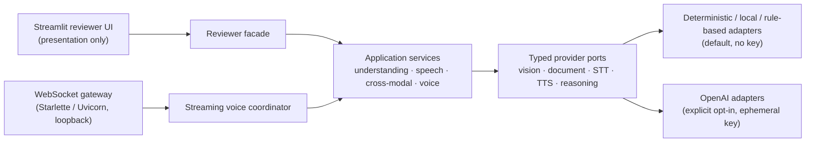

# Module 9 — Multimodal & Voice AI Systems


-412991)


A standalone multimodal and voice AI platform that processes text, images, documents, and audio, relates evidence across modalities, runs multi-turn voice conversations, and streams voice turns over a genuine WebSocket connection, while keeping deterministic, local, rule-based, and live-provider evidence clearly separated.

## Executive Summary

**What:** Module 9 delivers two connected systems from the course source: a **multimodal AI platform** (vision, document, and audio processing with cross-modal reasoning) and a **voice-enabled AI assistant** (speech-to-text, conversational reasoning, text-to-speech, bounded multi-turn state, and real-time streaming).

**How:** All business logic lives in a provider-neutral Python core behind typed ports. Default adapters are deterministic and need no key: committed fixtures, local Pillow/pypdf/standard-library processing, and closed-vocabulary rule-based reasoning. Opt-in OpenAI adapters for vision, speech-to-text, text-to-speech, and streamed reasoning sit behind the same ports. A Starlette/Uvicorn gateway carries voice turns over a typed WebSocket protocol. Streamlit is the reviewer presentation layer, not the authority boundary.

**Why:** Multimodal and voice systems are easy to overstate. A fixture transcript can look like speech recognition, a tone can look like speech synthesis, and a chunked reply can look like streaming. This module makes the processing kind, execution mode, and evidence class visible on every result, so a reviewer can see exactly what ran.

**Proof:** The [release readiness record](docs/RELEASE_READINESS.md) reviews all **30 requirements** individually (18 source-derived, 12 additive engineering): 13 source and all 12 engineering requirements are implemented, and **five source requirements remain explicitly partial**. The recorded local acceptance gate passed **827 automated tests** with Ruff and compileall. Separately authorized real-provider runs established OpenAI vision, speech-to-text, text-to-speech, model reasoning, and provider streaming (`live_integration`). Module 9 is **complete**: engineering acceptance, GitHub publication, the verified reviewer-facing Streamlit deployment, and recruiter-facing LinkedIn publication are done.

## Start Here / Reviewer Path

**Public Streamlit application:** https://dm-aiep-agent-engineering-module-09.streamlit.app

For the fastest hands-on review, follow the [Module 9 User Guide](docs/USER_GUIDE.md). It provides zero-key launch instructions, eight walkthroughs with expected results, live/BYOK boundaries, troubleshooting, and a focused 15-minute reviewer path. Deployment verification is recorded in the [release readiness record](docs/RELEASE_READINESS.md); you can also [run the app locally](#run-locally) with no key.

Recommended review order in the app sidebar:

1. **Multimodal workflow** → keep **Use repository-owned samples** checked → **Run selected workflow**. Inspect the four-modality result, the cross-modal findings, and **Normalized observations and citations**.
2. **Voice assistant** → run `voice-remember`, then `voice-recall`. Read the transcript and reply, listen to the generated audio, and inspect **Measured stage latency**.
3. **Document & vision** → run the image sample, then switch **Modality** to `document` and run again. Compare measured pixel facts with locally extracted text.
4. **WebSocket streaming** → run once normally, then again with **Disconnect after first response fragment (cancellation demo)** checked.
5. **Live / BYOK** (optional) → read the controls and boundaries before deciding whether to use your own key.

### Reviewer posture

The default **Deterministic demo** mode needs no API key and makes no provider network call or payment. Its transcripts are fixture playback, its generated audio is a tone sequence, and its reasoning is rule-based. None of that is model inference, speech recognition, or speech synthesis, and the application labels it that way. **Live / BYOK** is a separate opt-in path with a masked per-operation key, a cost acknowledgement, and no silent fallback.

## Key Capabilities

| Capability | What a reviewer can observe | Processing kind |
| --- | --- | --- |
| Validated multimodal ingestion | Magic-byte, UTF-8, size, and duration checks reject malformed or oversized files with safe messages | Local validation |
| Image analysis | Measured pixel facts (dimensions, quadrant colors) for PNG, JPEG, and WebP | Local Pillow analysis, not a vision model |
| Document processing | Extracted sections and structure from Markdown, plain text, and PDF | Local extraction, not semantic understanding or OCR |
| Audio processing | Strict PCM WAV parsing, decoding, and signal measurement | Local standard-library processing |
| Speech-to-text | Transcript for committed audio fixtures | Fixture playback by default; real OpenAI transcription in live mode |
| Text-to-speech | Playable, validated WAV audio for the assistant reply | Deterministic tone sequence by default; real OpenAI speech in live mode |
| Cross-modal reasoning | `corroborated`, `contradicted`, and other cited findings relating claims in one modality to measurements in another | Rule-based over a closed vocabulary; live model reasoning when opted in |
| Multi-turn voice assistant | `voice-remember` stores a code word and `voice-recall` retrieves it from bounded history | Rule-based conversation reasoning over two fixed phrasings |
| Real-time streaming | Typed events rendered as they arrive over a real loopback WebSocket, incremental reply fragments, and latency metrics | Genuine WebSocket transport; fragments are whole rule-based reply acts, not model tokens |
| Cancellation | Disconnecting after the first fragment cancels the running turn without committing it | Genuine transport disconnect |
| Prompt-injection containment | Embedded instructions in the sample document and the `voice-injection` utterance stay inert data | Application-enforced trust boundary |
| Opt-in live providers | OpenAI vision, transcription, speech, and streamed reasoning behind unchanged ports | `live_integration` only for real, explicitly authorized execution |

### Evidence classes

Every runtime record carries an evidence class enforced in code (`contracts/evidence.py`): `design_documentation`, `automated_test`, `deterministic_demo`, `live_integration`, and `deployment_release`. Deterministic results can never be labeled `live_integration`, and mocked transport cannot claim it. See the [evidence policy](docs/EVIDENCE_POLICY.md).

### Delivery by story

| Story | What it delivered | Evidence |
| --- | --- | --- |
| 9.1 Architecture & Contracts | Requirements, traceability, architecture, nine ADRs, threat model, and typed contracts. Design only | `design_documentation` |
| 9.2 Deterministic Multimodal Foundation | Committed text, image, audio, and document fixtures and deterministic, no-key fixture-playback adapters for the vision, document, and speech-to-text ports. No inference, network, key, or spend | `automated_test` |
| 9.3 Document + Vision Understanding | Validated image and document ingestion (magic bytes, UTF-8 checks, budgets); Pillow pixel analysis of PNG, JPEG, and WebP; extraction and structural analysis of Markdown, plain text, and PDF. No model inference, so not semantic understanding | `automated_test` |
| 9.4 Audio + Speech Pipeline | Strict PCM WAV parsing, decoding, and signal measurement with the standard library; STT and TTS pipelines through the provider ports. Deterministic transcripts are fixture playback, not speech recognition; generated audio is a tone sequence, not speech synthesis | `automated_test` |
| 9.5 Cross-Modal Reasoning Workflow | Two to four modalities normalized into typed observations in one bounded context and related through the `ReasoningPort`. The default reasoner judges claims from one modality against measurements from another, reports conflicts without resolving them, and cites every statement and measurement it uses. Not model inference | `automated_test` |
| 9.6 Voice-Enabled AI Assistant | Bounded multi-turn conversations: validated audio → audio processing → STT → bounded context → reasoning → TTS → generated-audio validation → atomic commit. Later turns recall earlier ones. Turns are synchronous; nothing is streamed at this layer | `automated_test` |
| 9.7 Real-Time WebSocket Streaming | Starlette ASGI gateway hosted by Uvicorn on loopback with a typed protocol, incremental reply fragments produced before the reply exists, latency metrics including time to first response, and cancellation on disconnect or timeout. No authentication | `automated_test`, including loopback socket-level tests |
| 9.8 Secure Opt-In Live Providers | OpenAI vision, STT, TTS, and streamed reasoning behind the unchanged ports, reachable only from an explicit opted-in live session with an ephemeral key. Deterministic tests exercise the real SDK over an in-process fake API | `automated_test` plus accepted `live_integration` |
| 9.9 Reviewer UI | Unified Streamlit application over the existing services: native microphone and file input, safe samples, transcripts, replies, playable audio, observations, cited findings, typed events, and timings | `automated_test` (AppTest and real loopback sockets) |
| 9.10 Production Acceptance & Release | Individual 30-requirement review, adversarial and integrated acceptance, three repaired defects with regressions, then GitHub publication and verified reviewer-facing Streamlit deployment | See [release readiness](docs/RELEASE_READINESS.md) |

## Architecture



The application core owns validation, provenance, bounds, state commits, and evidence classification. Providers sit behind ports and return **untrusted** output: model descriptions become statements labeled as model-derived, never measured facts. Uploaded content, transcripts, and model output are data and can never change execution mode, budgets, providers, or credentials.

A voice turn runs **validated audio → local audio processing → speech-to-text → bounded conversational context → reasoning → text-to-speech → generated-audio validation → atomic state commit**. A failure at any stage commits nothing.

The [architecture record](docs/ARCHITECTURE.md) is the technical source for layers, trust boundaries, and flows. Nine accepted [architecture decision records](docs/adr/) cover source fidelity, presentation separation, ports and adapters, execution modes, the streaming boundary, input normalization, untrusted content, cost and latency, and reviewer-visible evidence.

## Technology Stack

| Area | Technology |
| --- | --- |
| Language and environment | Python 3.12, uv, locked module dependencies |
| Contracts and validation | Pydantic |
| Image processing | Pillow |
| Document extraction | pypdf, plus Markdown and plain-text parsing |
| Audio processing | Python standard library (`wave` and strict RIFF/WAVE parsing) |
| Real-time transport | Starlette WebSocket gateway, Uvicorn, `websockets` client |
| Optional live provider | OpenAI SDK: Responses API (vision and streamed reasoning), audio transcriptions, audio speech |
| Reviewer UI | Streamlit |
| Quality gates | Ruff, pytest, compileall |

Default live models are configuration values (`gpt-5.4-mini` for vision and reasoning, `gpt-4o-mini-transcribe`, `gpt-4o-mini-tts`), not hard-coded logic. See [live providers](docs/LIVE_PROVIDERS.md).

## Production-Grade Engineering

### Honest processing labels

Each record states its execution mode, evidence class, and the processing kind of every stage (for example fixture playback versus real transcription). The UI shows these labels next to the result, and the full authoritative record stays inspectable.

### Bounded execution

Byte, duration, token, call, history, event, and deadline budgets apply at every boundary. Conversation history is bounded and expires. WebSocket sessions bound inbound message size, event counts, and send timeouts. Live calls use `max_retries=0`, request timeouts, operation deadlines, and capped output tokens.

### Atomic voice transactions

Voice turns commit to conversation state only after every stage succeeds. Replayed turn IDs are rejected. Disconnects and timeouts cancel the running turn without committing it.

### Genuine streaming

The gateway sends `turn_accepted`, `transcript_final`, one `response_delta` per reply fragment, `response_complete`, `audio_ready`, `turn_complete`, and latency `metric` events. Fragments are produced while reasoning is still running, before the reply exists, rather than split from a finished reply. There is no artificial typing delay.

### Explicit live opt-in

Live execution requires the **Live / BYOK** mode, a masked key, a cost acknowledgement, and an explicit submit, every time. Keys are removed from widget state before execution and are never cached, saved, logged, or read from the environment. Live failures are reported once and never fall back to deterministic output. Live voice uses one fresh session per operation, while deterministic voice preserves bounded multi-turn history. The streaming reviewer demonstration stays deterministic.

## Security and Trust Boundaries

- All uploaded, transcribed, retrieved, and model-produced content is untrusted data; it cannot grant authority or change mode, budget, provider, or credential.
- Cross-modal findings must cite real observations; forged citations, invented fact IDs, and forged evidence classes are rejected.
- Media is validated by content, not declared type; display names are never used as filesystem paths.
- Results render as plain text, native media, or JSON with central redaction. There is no untrusted HTML renderer, URL input, or arbitrary file selector.
- Credentials are redacted from serialized records, including JSON-escaped variants.
- The gateway refuses browser origins that are not configured, and the bundled Streamlit config binds to `127.0.0.1`, disables usage telemetry, and caps uploads at 2 MiB.
- **The WebSocket gateway has no authentication or TLS.** It is a loopback component and must not be exposed publicly as is.
- Clearing credential references is not cryptographic erasure of browser or process memory.

The [security threat model](docs/SECURITY_THREAT_MODEL.md) lists the threats and 26 security invariants.

## Testing and Verification

The Story 9.10 local acceptance gate, recorded on 2026-10-17, passed the fail-fast sequence from `module-09/`:

| Check | Recorded result |
| --- | --- |
| Ruff | PASS |
| Full pytest suite | 827 passed |
| compileall (`src`, `tests`, launcher) | PASS |
| Native UI, production-acceptance, and loopback WebSocket tests | 31 passed |

These are historical gate counts, not a fresh run performed during documentation normalization. Automated tests make zero real provider calls and need no key; live adapters are exercised through the real OpenAI SDK against an in-process fake API, which is `automated_test` evidence.

Adversarial coverage includes malformed, oversized, and mismatched media, traversal-like names, embedded instructions, forged citations and classifications, replayed turns, forged session metadata, unauthorized origins, protocol misuse, JSON-escaped credential canaries, and concurrent Streamlit worker isolation.

### Accepted live-provider evidence

Separately authorized real-provider runs (Story 9.8) established vision, speech-to-text, model reasoning, text-to-speech, and provider streaming as `live_integration`, plus one live voice turn over loopback WebSocket. These are single-run measurements, not a latency SLO, and they do not establish live multi-turn recall. Sanitized summaries are in [live providers](docs/LIVE_PROVIDERS.md); raw evidence stays outside the repository.

### Verified deployment

After Story 9.10, the reviewer-facing Streamlit deployment was verified with deterministic multimodal, voice, document/vision, and real loopback WebSocket normal and cancellation workflows, browser microphone capture, prompt-injection containment, the analyzed-image display, and one explicitly authorized opt-in BYOK live vision run. That run kept `live_integration` classification, separated the untrusted model interpretation from measured local facts, recorded provider usage, and cleared the submitted credential and acknowledgement afterward. The internal loopback WebSocket gateway is not separately exposed as a public authenticated or TLS service. No release tag is claimed.

## Run Locally

Install Python 3.12 and uv, then from `module-09/`:

```bash
uv sync --extra dev
uv run streamlit run streamlit_app.py
```

The app opens on `127.0.0.1` in **Deterministic demo** mode. Dependency installation may need network access; the deterministic workflows themselves need no key and make no provider call.

Run the quality gates fail-fast:

```bash
uv run ruff check .
uv run pytest
uv run python -m compileall -q src tests
```

Optionally run the standalone deterministic WebSocket gateway on `ws://127.0.0.1:8765/ws/voice`:

```bash
uv run python -m multimodal_voice_platform.interface
```

## Documentation / Deep Dives

| Document | Contents |
| --- | --- |
| [USER_GUIDE.md](docs/USER_GUIDE.md) | Reviewer walkthroughs, execution modes, live/BYOK use, and troubleshooting |
| [AUTHORITATIVE_SOURCE.md](docs/AUTHORITATIVE_SOURCE.md) | Verbatim source requirements |
| [REQUIREMENTS.md](docs/REQUIREMENTS.md) | Source-derived and additive requirements |
| [TRACEABILITY.md](docs/TRACEABILITY.md) | Requirement to story and evidence mapping |
| [ARCHITECTURE.md](docs/ARCHITECTURE.md) | Layers, trust boundaries, flows (Mermaid) |
| [adr/](docs/adr/) | ADR-009-001 to ADR-009-009 |
| [CONTRACTS.md](docs/CONTRACTS.md) | Modality, session, provider, streaming, evidence contracts |
| [DETERMINISTIC_FOUNDATION.md](docs/DETERMINISTIC_FOUNDATION.md) | Story 9.2 fixtures, deterministic adapters, run records |
| [UNDERSTANDING.md](docs/UNDERSTANDING.md) | Story 9.3 ingestion, local vision and document adapters, understanding records |
| [AUDIO_SPEECH.md](docs/AUDIO_SPEECH.md) | Story 9.4 audio processing, speech-to-text and text-to-speech pipelines, speech records |
| [CROSS_MODAL.md](docs/CROSS_MODAL.md) | Story 9.5 cross-modal workflow, observations, bounded context, deterministic reasoning rules, records |
| [VOICE_ASSISTANT.md](docs/VOICE_ASSISTANT.md) | Story 9.6 voice orchestration, conversation state and bounds, transaction semantics, conversation rules, records |
| [STREAMING.md](docs/STREAMING.md) | Story 9.7 WebSocket gateway, streaming protocol, incremental streaming evidence, bounds, cancellation, latency metrics |
| [LIVE_PROVIDERS.md](docs/LIVE_PROVIDERS.md) | Story 9.8 OpenAI live adapters, mode selection, ephemeral BYOK, redaction, failures, cost controls, evidence ladder, live acceptance |
| [REVIEWER_UI.md](docs/REVIEWER_UI.md) | Story 9.9 reviewer UI controls, evidence, and limitations |
| [RELEASE_READINESS.md](docs/RELEASE_READINESS.md) | Story 9.10 requirement decisions, security/functional evidence, regression repairs, residual risks, release closeout |
| [SECURITY_THREAT_MODEL.md](docs/SECURITY_THREAT_MODEL.md) | Threats and 26 security invariants |
| [STORIES.md](docs/STORIES.md) | Stories 9.1 to 9.10 |
| [DEFINITION_OF_DONE.md](docs/DEFINITION_OF_DONE.md) | Module completion criteria and quality gates |
| [EVIDENCE_POLICY.md](docs/EVIDENCE_POLICY.md) | Evidence classes; deterministic vs live |
| [PROJECT_STATUS.md](docs/PROJECT_STATUS.md) | Story-by-story status and implemented capabilities |
| [governance/module-09-governance.json](docs/governance/module-09-governance.json) | Machine-readable governance |

Source: [`multimodal_voice_platform` package](src/multimodal_voice_platform/) and [reviewer app](src/multimodal_voice_platform/ui/app.py). Portfolio context: [Repo 2 README](../README.md).

## Evidence and Limitations

| Area | Established | Not established |
| --- | --- | --- |
| Vision | Local pixel measurement; accepted live OpenAI vision kept separate from measured facts | Vision-model output as trusted fact |
| Documents | Local Markdown, text, and PDF extraction and structure | Semantic document understanding or OCR (SRC-004 partial) |
| Audio | Validated PCM WAV decoding and signal measurement | MP3 or WebM decoding (SRC-003 partial) |
| Speech-to-text | Fixture playback by default; accepted live final transcription | Genuine partial transcription (SRC-006 partial) |
| Text-to-speech | Validated generated WAV; accepted live speech synthesis | Speech synthesis in deterministic mode (it is a tone) |
| Reasoning | Rule-based cross-modal and conversation reasoning; accepted live model reasoning | Arbitrary semantic reasoning in deterministic mode |
| Voice assistant | Deterministic multi-turn recall; one accepted live voice turn | Live multi-turn recall (live UI voice is one turn per session) |
| Streaming | Genuine loopback WebSocket events, incremental fragments, and cancellation | Authenticated or TLS-protected public WebSocket service |
| Latency | Measured stage and milestone timings, deadlines, incremental delivery | A production latency SLO (SRC-012 partial) |
| Voice interface | Native Streamlit microphone and WAV input; verified browser microphone capture | Deployed live spoken interaction (SRC-013 partial) |
| Deployment | Verified reviewer-facing Streamlit app with deterministic workflows and opt-in BYOK vision | Production SLO, load, or public authenticated WebSocket hosting |

These five partial source requirements are stated rather than waived. Semantic document understanding, OCR, MP3/WebM decoding, and genuine partial transcription remain unestablished, and no production latency SLO is claimed. Live voice UI execution and live multi-turn recall were not re-exercised after deployment.

Module 9 is **complete and published**: engineering acceptance, GitHub publication, the verified reviewer-facing Streamlit deployment, and recruiter-facing LinkedIn publication are done. Story-era documents record status as of their own review dates; [RELEASE_READINESS.md](docs/RELEASE_READINESS.md) is the latest release record.

---

Developed from Techademy AI Engineering Program requirements with independent architecture, provider-neutral ports, deterministic no-key review, explicit opt-in BYOK live providers, adversarial testing, and explicit evidence classification.
