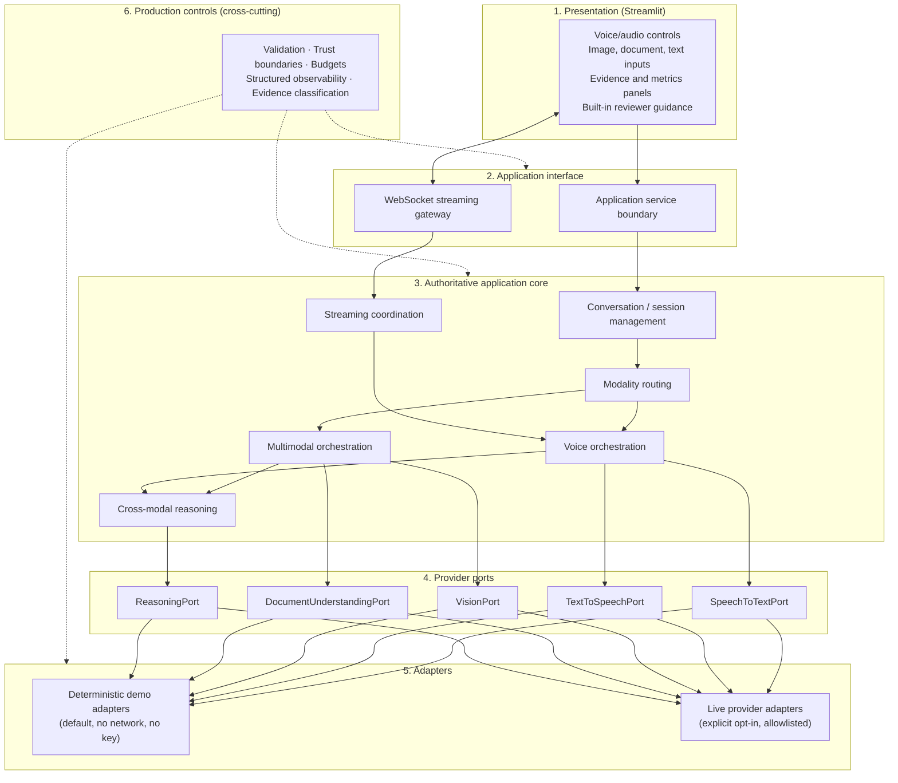
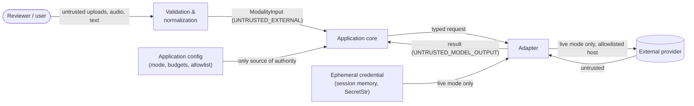
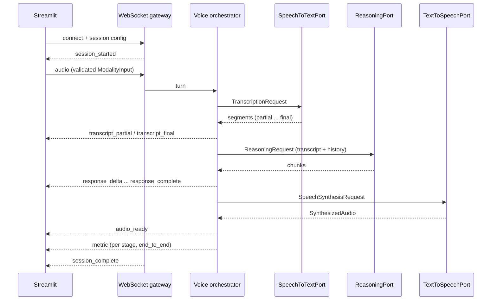
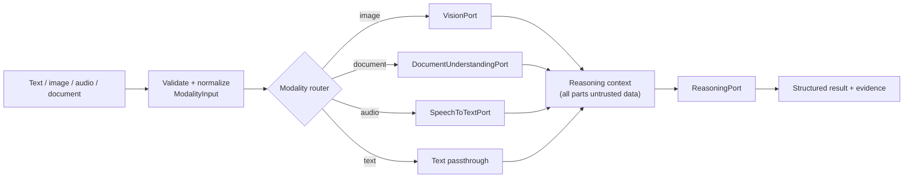

# Module 9 Architecture

## Status

Frozen by the human-approved Story 9.1 specification (2026-10-14). Reopen only for a genuine
contradiction with the authoritative source or a serious production/security flaw.

This document describes the target architecture. Story 9.1 implements none of the runtime
components below. It provides only the typed contracts in
`src/multimodal_voice_platform/contracts/`. See [CONTRACTS.md](CONTRACTS.md).

## Goal

A production-grade, secure multimodal AI platform that provides a voice-enabled conversational
assistant; image, audio, document, and text processing; vision and document understanding;
cross-modal reasoning; STT and TTS; real-time conversations and voice orchestration; genuine
WebSocket streaming with measured low latency; a deterministic no-key reviewer mode; an explicit
opt-in live-provider mode; and a Streamlit reviewer experience showing real, classified evidence.

## Logical layers



| Layer | Responsibility | Must not |
|---|---|---|
| Presentation | Collect input, render results, stream events, metrics, evidence, guidance | Hold business logic, call providers directly, persist credentials |
| Application interface | Typed service calls; WebSocket session lifecycle and typed stream protocol | Accept unvalidated payloads; leak internal errors |
| Application core | Sessions, routing, voice and multimodal orchestration, reasoning context, streaming | Trust content or provider output as instructions or authority |
| Provider ports | Typed contracts for STT, TTS, vision, document, reasoning | Expose tool execution or shell access |
| Adapters | Deterministic and live implementations of the ports | Deterministic: touch the network. Live: run without explicit opt-in |
| Production controls | Validation, trust, budgets, observability, evidence | Become a correctness dependency (observability) |

## Trust boundaries



Authority comes only from application configuration and code. Content, transcripts, metadata, and
model output are data. See [SECURITY_THREAT_MODEL.md](SECURITY_THREAT_MODEL.md).

## Voice turn (target flow, Story 9.6/9.7)



## Multimodal workflow (target flow, Story 9.3/9.5)



Modality-specific processing always precedes cross-modal reasoning (ADR-009-006).

## Execution modes

| Mode | Default | Network | Credentials | Evidence class produced |
|---|---|---|---|---|
| `deterministic` | Yes | None | None | `automated_test`, `deterministic_demo` |
| `live` | No; explicit opt-in | Allowlisted providers only | Ephemeral, user-supplied | `live_integration` |

Both modes use the same ports and application contracts (ADR-009-004).

## Package layout

```text
module-09/
  pyproject.toml                         standalone project (Python 3.12)
  src/multimodal_voice_platform/
    contracts/                           Story 9.1: typed contracts only
      modality.py   session.py   providers.py
      streaming.py  limits.py    evidence.py   errors.py
    (core/, adapters/, interface/, ui/)  later stories; not created yet
  tests/                                 contract and governance tests
  docs/                                  requirements, architecture, ADRs, governance
```

## Deferred decisions

These are implementation choices left to the owning story. They must fit the frozen architecture.

| Decision | Owning story |
|---|---|
| WebSocket server framework and hosting process | 9.7 |
| Deterministic fixture formats and generation | 9.2 |
| Image/document parsing libraries and magic-byte checks | 9.3 |
| Audio decoding library and sample formats | 9.4 |
| Specific live providers and models | 9.8 |
| Deployment target and packaging | 9.10 |
