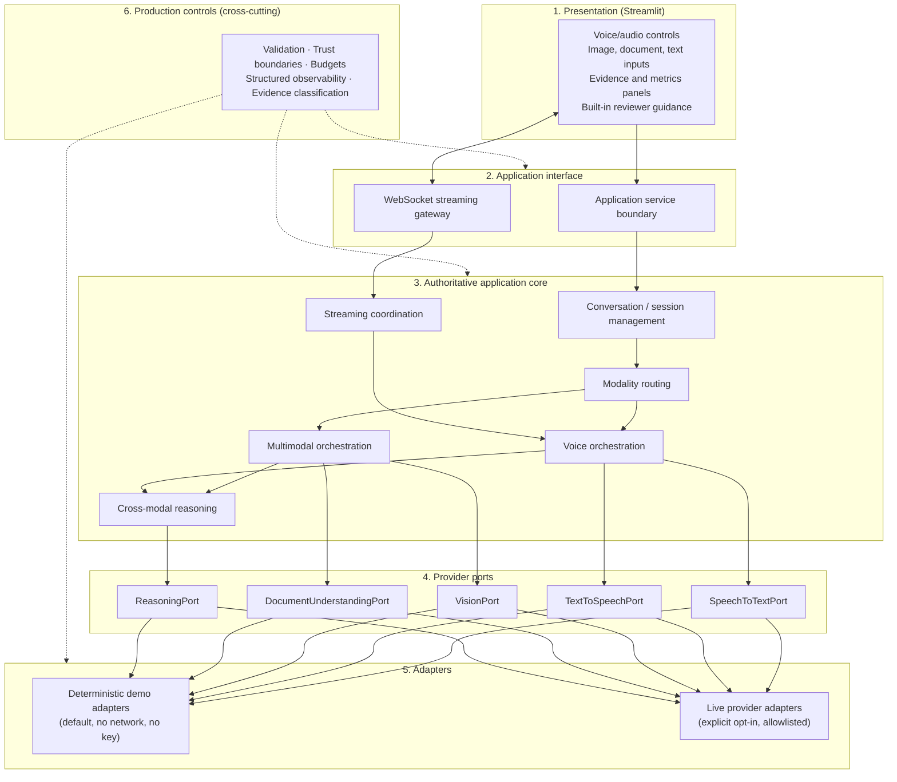
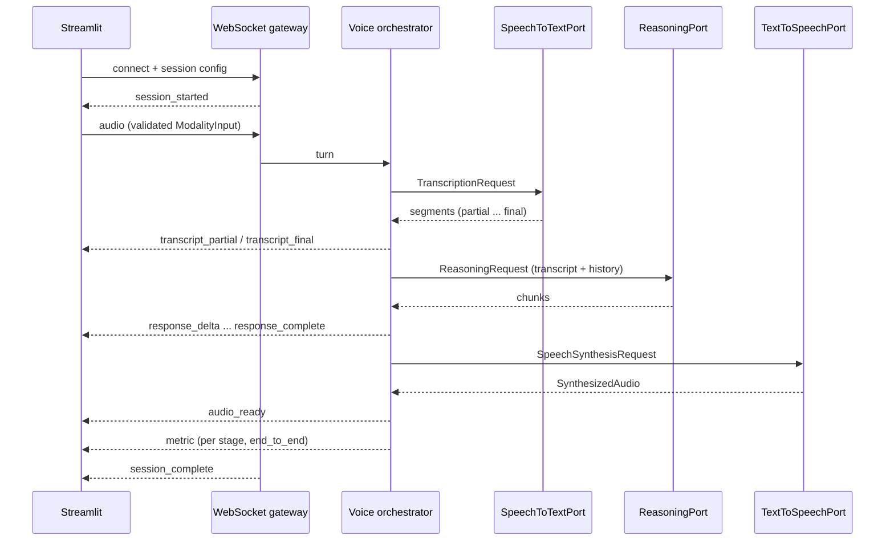
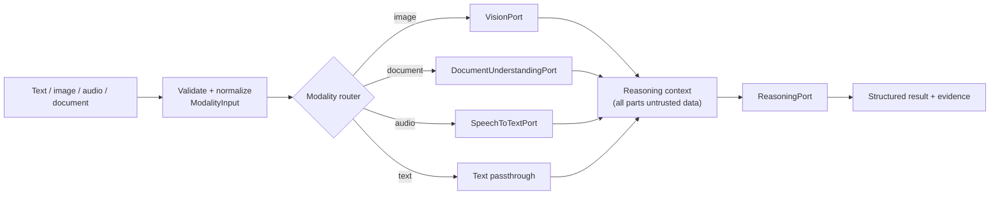

# Module 9 Architecture

## Status

Frozen by the human-approved Story 9.1 specification (2026-10-14). Reopen only for a genuine
contradiction with the authoritative source or a serious production/security flaw.

This document describes the target architecture. Story 9.1 provides the typed contracts in
`src/multimodal_voice_platform/contracts/` (see [CONTRACTS.md](CONTRACTS.md)). Story 9.2 adds
deterministic fixture-playback adapters for the vision, document, and speech-to-text ports in
`src/multimodal_voice_platform/adapters/deterministic/` (see
[DETERMINISTIC_FOUNDATION.md](DETERMINISTIC_FOUNDATION.md)). Story 9.3 adds the image and document
ingestion boundary (`ingestion/`), local processing adapters for the vision and document ports
(`adapters/local/`), and the understanding service and records (`understanding/`) (see
[UNDERSTANDING.md](UNDERSTANDING.md)). Story 9.4 adds audio ingestion and processing (`audio/`), a
deterministic tone-sequence `TextToSpeechPort` adapter (`adapters/speech/`), and the speech pipeline
service and records (`speech/`) (see [AUDIO_SPEECH.md](AUDIO_SPEECH.md)). Story 9.5 adds the
multimodal orchestration, modality routing, and cross-modal reasoning core (`crossmodal/`), the
structured reasoning contract (`contracts/reasoning.py`), and a deterministic rule-based
`ReasoningPort` adapter (`adapters/reasoning/`), which is not model inference (see
[CROSS_MODAL.md](CROSS_MODAL.md)). Story 9.6 adds conversation/session management and voice
orchestration (`voice/`), the structured reply contract (`contracts/conversation.py`), and a
deterministic rule-based conversation `ReasoningPort` adapter (`adapters/reasoning/conversation.py`),
which is not model inference; its turns are synchronous and stream nothing (see
[VOICE_ASSISTANT.md](VOICE_ASSISTANT.md)). Story 9.7 adds streaming coordination (`streaming/`), the
WebSocket streaming gateway and its loopback server (`interface/`), client messages and turn events
in the streaming protocol, and an incremental reply port with a lazy rule-based adapter; its reply
fragments are not model tokens (see [STREAMING.md](STREAMING.md)). Story 9.8 adds the live
adapters (`adapters/openai/`, OpenAI as the first live provider) behind the unchanged ports, the
provider-neutral live core (`live/`, `contracts/live.py`), and explicit live bindings in the
services; accepted real-provider evidence establishes vision, STT, TTS, model reasoning, and
provider streaming without changing the frozen architecture (see [LIVE_PROVIDERS.md](LIVE_PROVIDERS.md)).
Story 9.9 adds the thin Streamlit reviewer presentation described in
[REVIEWER_UI.md](REVIEWER_UI.md). The application/domain/provider boundaries are unchanged.
Deployment and final production acceptance remain Story 9.10.

## Goal

A production-grade, secure multimodal AI platform that provides a voice-enabled conversational
assistant; image, audio, document, and text processing; vision and document understanding;
cross-modal reasoning; STT and TTS; real-time conversations and voice orchestration; genuine
WebSocket streaming with measured low latency; a deterministic no-key reviewer mode; an explicit
opt-in live-provider mode; and a Streamlit reviewer experience showing real, classified evidence.

## Logical layers



| Layer | Responsibility | Must not |
|---|---|---|
| Presentation | Collect input, render results, stream events, metrics, evidence, guidance | Hold business logic, call providers directly, persist credentials |
| Application interface | Typed service calls; WebSocket session lifecycle and typed stream protocol | Accept unvalidated payloads; leak internal errors |
| Application core | Sessions, routing, voice and multimodal orchestration, reasoning context, streaming | Trust content or provider output as instructions or authority |
| Provider ports | Typed contracts for STT, TTS, vision, document, reasoning | Expose tool execution or shell access |
| Adapters | Deterministic and live implementations of the ports | Deterministic: touch the network. Live: run without explicit opt-in |
| Production controls | Validation, trust, budgets, observability, evidence | Become a correctness dependency (observability) |

## Trust boundaries


Authority comes only from application configuration and code. Content, transcripts, metadata, and
model output are data. See [SECURITY_THREAT_MODEL.md](SECURITY_THREAT_MODEL.md).

## Voice turn (target flow, Story 9.6/9.7)

Story 9.6 implements the orchestrator side of this flow synchronously: `VoiceAssistant.run_turn`
runs STT, reasoning over the transcript and bounded history, and TTS, then commits the exchange and
returns one `VoiceTurnRecord` with per-stage and end-to-end timings. Story 9.7 implements the
WebSocket gateway and the streamed events below through `StreamingVoiceCoordinator`, except
`transcript_partial`, which is not sent because fixture-playback STT produces no genuine partial
transcript; it also adds `turn_accepted` and `turn_complete` (see [STREAMING.md](STREAMING.md)).



## Multimodal workflow (target flow, Story 9.3/9.5)



Modality-specific processing always precedes cross-modal reasoning (ADR-009-006). Story 9.5
implements this flow with `CrossModalWorkflow`; the reasoning context is one JSON-encoded
`ObservationView` per input, and the reasoning output is citation-checked before it is recorded.

## Execution modes

| Mode | Default | Network | Credentials | Evidence class produced |
|---|---|---|---|---|
| `deterministic` | Yes | None | None | `automated_test`, `deterministic_demo` |
| `live` | No; explicit opt-in | Allowlisted providers only | Ephemeral, user-supplied | `live_integration` |

Both modes use the same ports and application contracts (ADR-009-004).

## Package layout

```text
module-09/
  pyproject.toml                         standalone project (Python 3.12)
  src/multimodal_voice_platform/
    contracts/                           Story 9.1: typed contracts only
      modality.py   session.py   providers.py
      streaming.py  limits.py    evidence.py   errors.py
    adapters/deterministic/              Story 9.2: no-key fixture playback (no inference)
      fixture_data/                      committed fixtures + manifest
    ingestion/                           Story 9.3: magic-byte/UTF-8 validation and staging
    adapters/local/                      Story 9.3: local image analysis, document extraction
    understanding/                       Story 9.3: understanding service and records
    audio/                               Story 9.4: audio ingestion, PCM WAV parsing, signal analysis
    adapters/speech/                     Story 9.4: deterministic tone-sequence TTS adapter
    speech/                              Story 9.4: speech pipeline service and records
    contracts/reasoning.py               Story 9.5: structured reasoning I/O contract
    adapters/reasoning/                  Story 9.5: deterministic rule-based reasoning adapter
    crossmodal/                          Story 9.5: cross-modal workflow, context, records
    contracts/conversation.py            Story 9.6: structured voice reply contract
    adapters/reasoning/conversation.py   Story 9.6: deterministic conversation reasoning adapter
    voice/                               Story 9.6: voice orchestrator, conversation state, records
      fixture_data/                      committed conversation fixtures + manifest
    streaming/                           Story 9.7: streaming coordinator, limits, records
    interface/                           Story 9.7: WebSocket gateway (Starlette), loopback server (Uvicorn)
    contracts/live.py                    Story 9.8: live call evidence and the live evidence ladder
    live/                                Story 9.8: live config, credentials, bindings, redaction,
                                         prompts, acceptance runner (provider-neutral)
    adapters/openai/                     Story 9.8: OpenAI live adapters (provider-specific)
    ui/                                  Story 9.9: Streamlit presentation, service facade,
                                         short-lived loopback WebSocket client
  tests/                                 contract and governance tests
  docs/                                  requirements, architecture, ADRs, governance
```

## Deferred decisions

These are implementation choices left to the owning story. They must fit the frozen architecture.

| Decision | Owning story |
|---|---|
| WebSocket server framework and hosting process | 9.7 (decided: Starlette ASGI application hosted by Uvicorn with the sans-I/O `websockets` protocol; loopback only until 9.10) |
| Deterministic fixture formats and generation | 9.2 (decided: stdlib-generated PNG/WAV, plain text, Markdown; SHA-256 manifest) |
| Image/document parsing libraries and magic-byte checks | 9.3 (decided: Pillow for PNG/JPEG/WebP, pypdf for PDF, stdlib Markdown/text parsing, stdlib magic-byte sniffing) |
| Audio decoding library and sample formats | 9.4 (decided: standard library only; integer PCM WAV at 8/16/24/32 bits; MP3/WebM recognized but not decoded) |
| Specific live providers and models | 9.8 (decided: OpenAI first, behind provider-neutral ports; Responses API for vision and reasoning, audio transcriptions and speech APIs; models configurable) |
| Deployment target and packaging | 9.10 |
