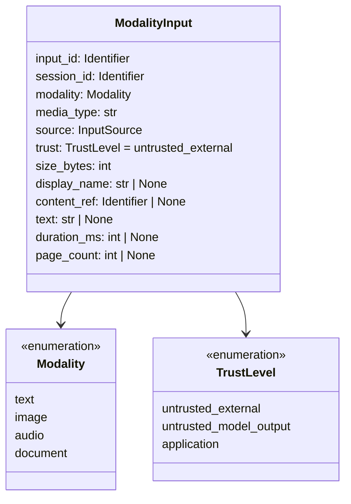

# Module 9 Contract Design

Story 9.1 defines typed contracts in `src/multimodal_voice_platform/contracts/`. They are
Pydantic v2 models (frozen, `extra="forbid"`) and `typing.Protocol` ports. They define shapes and
invariants only. Story 9.2 implements the vision, document, and speech-to-text ports with
deterministic fixture-playback adapters, and Story 9.3 implements the vision and document ports
with local processing adapters. Story 9.4 implements the text-to-speech port with a
deterministic tone-sequence adapter and drives both speech ports through the speech pipeline.
None of them change these contracts (see
[DETERMINISTIC_FOUNDATION.md](DETERMINISTIC_FOUNDATION.md), [UNDERSTANDING.md](UNDERSTANDING.md),
and [AUDIO_SPEECH.md](AUDIO_SPEECH.md)).
Story 9.5 adds `reasoning.py`, the structured contract carried over the unchanged reasoning port, and
implements the port with a deterministic rule-based adapter (see [CROSS_MODAL.md](CROSS_MODAL.md)).
Story 9.6 adds `conversation.py`, the structured reply contract carried over the same reasoning
port for voice turns, and implements the port with a deterministic conversation adapter (see
[VOICE_ASSISTANT.md](VOICE_ASSISTANT.md)). Story 9.7 extends `streaming.py` within protocol version 1
(client messages, `turn_accepted`, `turn_complete`, `turn_id`, metric `measure`, audio digest) and
`conversation.py` (`ReplyFragment`, `IncrementalReplyPort`), and adds five latency stages (see
[STREAMING.md](STREAMING.md)). Story 9.8 adds `live.py` (`LiveCall`, `ProviderUsage`, the live
evidence ladder) and four provider error codes (`provider_authentication_failed`,
`provider_permission_denied`, `provider_rate_limited`, `provider_refused`); live adapters implement
the existing ports unchanged (see [LIVE_PROVIDERS.md](LIVE_PROVIDERS.md)).

| Module | Boundary | Key types | ADRs |
|---|---|---|---|
| `limits.py` | Cost and latency | Hard ceilings, `ResourceBudget`, `LatencyStage` | 008 |
| `modality.py` | Multimodal input | `Modality`, `TrustLevel`, `InputSource`, `MEDIA_TYPES`, `ModalityInput` | 006, 007 |
| `session.py` | Session and mode | `ExecutionMode`, `ConversationTurn`, `LiveCredential`, `SessionConfig` | 004, 007 |
| `providers.py` | Provider ports | `ProviderPort`, request/result models, five `*Port` protocols | 003, 007 |
| `streaming.py` | WebSocket protocol | `StreamEventType`, eleven event models, `parse_stream_event`; client messages and `parse_client_message` (Story 9.7) | 005 |
| `evidence.py` | Evidence | `EvidenceClass`, `EvidenceRecord` | 009 |
| `errors.py` | Safe errors | `ErrorCode`, `SafeError`, `Module9Error`, `StreamProtocolError` | 005, 007 |
| `reasoning.py` | Structured reasoning I/O (Story 9.5) | `ObservationView`, `ObservedFact`, `Statement`, `FactOrigin`, `CrossModalFinding`, `FindingKind`, `ReasonerOutput` | 003, 006, 007 |
| `live.py` | Live call evidence (Story 9.8) | `LiveCall`, `ProviderUsage`, `LiveCapability`, `live_evidence`, `check_live_evidence` | 004, 008, 009 |
| `conversation.py` | Structured voice reply (Story 9.6); incremental reply (Story 9.7) | `AssistantReply`, `ReplyAct`, `ReplyActKind`, `ReplyFragment`, `IncrementalReplyPort` | 003, 007 |

## Modality contract

Invariants (all fail closed):

- `trust` must be `untrusted_external`.
- `media_type` must be on the allowlist for the modality; `display_name` extension must match it.
- `display_name` rejects path separators, reserved characters, control characters, leading dots,
  and `..`.
- Text is inline (`size_bytes` equals its UTF-8 length). Image, audio, and document content is an
  opaque `content_ref`, never a path.
- Size stays within the hard ceiling for the modality. Audio requires `duration_ms` within its
  ceiling. Documents respect the page ceiling. Metadata for the wrong modality is rejected.

Media type allowlist:

| Modality | Media types (extensions) |
|---|---|
| text | `text/plain` (.txt) |
| image | `image/png` (.png), `image/jpeg` (.jpg, .jpeg), `image/webp` (.webp) |
| audio | `audio/wav` (.wav), `audio/mpeg` (.mp3), `audio/webm` (.webm) |
| document | `application/pdf` (.pdf), `text/markdown` (.md), `text/plain` (.txt) |

Content sniffing for image and document input is implemented by Story 9.3 in `ingestion/`: magic
bytes for PNG, JPEG, WebP, and PDF, and strict UTF-8 text checks for Markdown and plain text. Audio
sniffing is implemented by Story 9.4 in `audio/`: signatures for WAV, MP3, and WebM, of which only
integer PCM WAV is decoded.

## Session contract

- `ExecutionMode.DETERMINISTIC` is the default.
- `LIVE` requires `live_opt_in=True`, a `LiveCredential`, and a provider in
  `allowed_live_providers` (empty by default; explicit Story 9.8 live sessions configure it).
- Deterministic sessions reject credentials and opt-in flags, so a credential alone never selects
  live mode.
- `LiveCredential.api_key` is a `SecretStr`. `SessionConfig.credential` is excluded from
  serialization and repr.
- `ConversationTurn` binds user turns to `untrusted_external` and assistant turns to
  `untrusted_model_output`.

## Provider ports

```mermaid
classDiagram
    class SpeechToTextPort {
        descriptor: ProviderDescriptor
        transcribe(TranscriptionRequest) AsyncIterator~TranscriptSegment~
    }
    class TextToSpeechPort {
        descriptor: ProviderDescriptor
        synthesize(SpeechSynthesisRequest) SynthesizedAudio
    }
    class VisionPort {
        descriptor: ProviderDescriptor
        analyze(VisionRequest) VisionResult
    }
    class DocumentUnderstandingPort {
        descriptor: ProviderDescriptor
        understand(DocumentRequest) DocumentResult
    }
    class ReasoningPort {
        descriptor: ProviderDescriptor
        stream_reason(ReasoningRequest) AsyncIterator~ReasoningChunk~
    }
    class ProviderResult {
        provider: ProviderDescriptor
        trust = untrusted_model_output
    }
    ProviderResult <|-- TranscriptSegment
    ProviderResult <|-- SynthesizedAudio
    ProviderResult <|-- VisionResult
    ProviderResult <|-- DocumentResult
    ProviderResult <|-- ReasoningChunk
```

- Each request checks it received the right modality.
- Every result is `untrusted_model_output` and carries the `ProviderDescriptor` (adapter ID, port,
  execution mode), so evidence can be attributed to deterministic or live execution.
- `ReasoningRequest.task` is application-authored. `parts` and `history` are untrusted data.
  Parts, history, and output tokens are bounded.
- Ports expose no tool execution.

## Structured reasoning contract (Story 9.5)

`ReasoningPort` streams text, so cross-modal reasoning carries structured JSON over it in both
directions:

- Each `ReasoningPart.content` is one canonical `ObservationView`: observation ID, modality, input
  ID, source, trust, facts, and statements. Facts are `local_measurement` or `local_extraction`
  only; statement origins must fit the modality (`user_provided` text, `local_extraction` document
  text, `fixture_playback` or `provider_contract_test_double` transcripts); `model_inference` is
  never accepted; text observations are `untrusted_external`, all others `untrusted_model_output`.
- The adapter streams one `ReasonerOutput`: `schema_version` 1 and at most 64 `CrossModalFinding`s.
  Each finding has a kind (`corroborated`, `contradicted`, `claim_conflict`, `claim_agreement`,
  `unverified_claim`, `shared_concepts`) and must carry the citations its kind requires: claim
  references with exact quotes, fact IDs, or shared terms.
- Every model is frozen with `extra="forbid"`. Whether citations exist in a given context is checked
  by the application core, never assumed.

## Voice reply contract (Story 9.6)

A voice turn sends one `ReasoningPart` (the current turn's `ObservationView`, whose statements are
the transcript) and the bounded conversation history in `ReasoningRequest.history`. The adapter
streams back one `AssistantReply`: `schema_version` 1, the reply text to speak (at most 1,000
characters), and one to eight `ReplyAct`s. Each act cites a statement ID and an exact quote; its
kind fixes which other citations it carries:

| Kind | Name and value | History citation |
|---|---|---|
| `remembered` | Both | None |
| `recalled` | Both | `history_index` and `history_quote` |
| `not_recalled` | Name only | None |
| `heard` | Neither | None |

Every model is frozen with `extra="forbid"`. Whether citations exist in the turn and its history is
checked by the application core (`voice.reply`), never assumed.

## Streaming protocol

Every event carries `protocol_version`, `session_id`, `sequence`, an optional `turn_id` (set by
the Story 9.7 server on every turn-scoped event), and a `type` discriminator.

| `type` | Payload |
|---|---|
| `session_started` | `mode` |
| `transcript_partial` | `text` (bounded) |
| `transcript_final` | `text` (bounded) |
| `response_delta` | `index`, `text` (1 to 4,000 chars) |
| `response_complete` | `finish_reason`, `delta_count` |
| `audio_ready` | `audio_ref`, `media_type` (audio allowlist), `duration_ms`; optional `audio_sha256`, `size_bytes` (9.7) |
| `metric` | `stage` (`LatencyStage`), `duration_ms` (finite); `measure` (`stage`, `since_turn_received`, `since_connect`; 9.7) |
| `error` | `error` (`SafeError`) |
| `session_complete` | `reason` |
| `turn_accepted` (9.7) | none |
| `turn_complete` (9.7) | `status`, `committed`, `conversation_sequence`, `failed_stage`, `delta_count`, `evidence_class`, `execution_mode`, processing kinds; outcome invariants enforced |

`parse_stream_event` rejects messages over 64 KiB, malformed JSON, unknown types, extra fields, and
invariant violations by raising `StreamProtocolError` (chained from the validation error).
`serialize_stream_event` refuses to produce an event over 64 KiB.

Client messages (Story 9.7) are `voice_turn` (`turn_id`, `media_type`, `display_name`,
`audio_base64`, optional `language`), `fixture_turn` (`turn_id`, `fixture_id`, optional `language`),
and `end_session`. They carry no session, mode, budget, provider, trust, or evidence field.
`parse_client_message` checks the size before parsing (`ClientMessageTooLargeError`) and rejects
everything outside the union; `VoiceTurnMessage.audio_bytes` decodes canonical base64 only, within a
byte bound.

## Budgets and latency

`ResourceBudget` bounds image, audio, and document bytes; audio duration; document pages; output
tokens; request and session timeouts; retries (at most 3); history turns; and provider calls per
session. Every field has a hard ceiling. Retries must stay below the provider-call budget, and the
request timeout cannot exceed the session timeout.

`LatencyStage`: `ingestion`, `speech_to_text`, `vision`, `document_understanding`, `reasoning`,
`first_response`, `text_to_speech`, `end_to_end`, and (Story 9.7) `session_setup`,
`turn_acceptance`, `transcript_ready`, `response_completion`, `audio_ready`.

## Evidence

See [EVIDENCE_POLICY.md](EVIDENCE_POLICY.md). `EvidenceRecord` ties each claim to a story, its
requirement IDs, an evidence class, runtime and live flags, and the execution mode, and rejects
contradictions.

## Story 9.8 accepted contract evidence

Accepted real-provider vision, STT, TTS, reasoning, and streaming evidence is `live_integration`;
SDK execution over fake transport remains `automated_test`. Explicit opt-in ephemeral BYOK, fixed
provider endpoint allowlisting, redaction, zero automatic live retries, bounded calls/tokens/time,
and no deterministic fallback remain enforced. Provider/model output is untrusted and grants no
authority. Pydantic and provenance validation remain fail-closed, including literal whole-word,
case-insensitive shared-term membership in each cited observation's statement text; fewer than
two qualifying terms means omitting `shared_concepts`. This evidence does not complete UI or
production acceptance. See [LIVE_PROVIDERS.md](LIVE_PROVIDERS.md).

## Story 9.9 presentation boundary

`ui/reviewer.py` selects existing service interfaces and returns their typed records. `Upload`
adds a 2 MiB presentation admission bound; existing ingestion remains authoritative for type,
magic bytes and names. No UI-controlled evidence/provider/authority fields enter a core request.
The `ui/socket_demo.py` transport parses every genuine loopback event using `parse_stream_event`,
invoking the renderer on receipt. It does not replace streaming or accept arbitrary endpoints.
