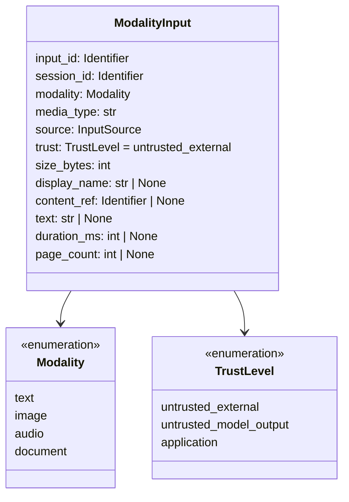

# Module 9 Contract Design

Story 9.1 defines typed contracts in `src/multimodal_voice_platform/contracts/`. They are
Pydantic v2 models (frozen, `extra="forbid"`) and `typing.Protocol` ports. They define shapes and
invariants only. Story 9.2 implements the vision, document, and speech-to-text ports with
deterministic fixture-playback adapters, and Story 9.3 implements the vision and document ports
with local processing adapters. Story 9.4 implements the text-to-speech port with a
deterministic tone-sequence adapter and drives both speech ports through the speech pipeline.
None of them change these contracts (see
[DETERMINISTIC_FOUNDATION.md](DETERMINISTIC_FOUNDATION.md), [UNDERSTANDING.md](UNDERSTANDING.md),
and [AUDIO_SPEECH.md](AUDIO_SPEECH.md)).
No live provider or transport exists yet.

| Module | Boundary | Key types | ADRs |
|---|---|---|---|
| `limits.py` | Cost and latency | Hard ceilings, `ResourceBudget`, `LatencyStage` | 008 |
| `modality.py` | Multimodal input | `Modality`, `TrustLevel`, `InputSource`, `MEDIA_TYPES`, `ModalityInput` | 006, 007 |
| `session.py` | Session and mode | `ExecutionMode`, `ConversationTurn`, `LiveCredential`, `SessionConfig` | 004, 007 |
| `providers.py` | Provider ports | `ProviderPort`, request/result models, five `*Port` protocols | 003, 007 |
| `streaming.py` | WebSocket protocol | `StreamEventType`, nine event models, `parse_stream_event` | 005 |
| `evidence.py` | Evidence | `EvidenceClass`, `EvidenceRecord` | 009 |
| `errors.py` | Safe errors | `ErrorCode`, `SafeError`, `Module9Error`, `StreamProtocolError` | 005, 007 |

## Modality contract

Invariants (all fail closed):

- `trust` must be `untrusted_external`.
- `media_type` must be on the allowlist for the modality; `display_name` extension must match it.
- `display_name` rejects path separators, reserved characters, control characters, leading dots,
  and `..`.
- Text is inline (`size_bytes` equals its UTF-8 length). Image, audio, and document content is an
  opaque `content_ref`, never a path.
- Size stays within the hard ceiling for the modality. Audio requires `duration_ms` within its
  ceiling. Documents respect the page ceiling. Metadata for the wrong modality is rejected.

Media type allowlist:

| Modality | Media types (extensions) |
|---|---|
| text | `text/plain` (.txt) |
| image | `image/png` (.png), `image/jpeg` (.jpg, .jpeg), `image/webp` (.webp) |
| audio | `audio/wav` (.wav), `audio/mpeg` (.mp3), `audio/webm` (.webm) |
| document | `application/pdf` (.pdf), `text/markdown` (.md), `text/plain` (.txt) |

Content sniffing for image and document input is implemented by Story 9.3 in `ingestion/`: magic
bytes for PNG, JPEG, WebP, and PDF, and strict UTF-8 text checks for Markdown and plain text. Audio
sniffing is implemented by Story 9.4 in `audio/`: signatures for WAV, MP3, and WebM, of which only
integer PCM WAV is decoded.

## Session contract

- `ExecutionMode.DETERMINISTIC` is the default.
- `LIVE` requires `live_opt_in=True`, a `LiveCredential`, and a provider in
  `allowed_live_providers` (empty by default, so live fails closed until Story 9.8 configures it).
- Deterministic sessions reject credentials and opt-in flags, so a credential alone never selects
  live mode.
- `LiveCredential.api_key` is a `SecretStr`. `SessionConfig.credential` is excluded from
  serialization and repr.
- `ConversationTurn` binds user turns to `untrusted_external` and assistant turns to
  `untrusted_model_output`.

## Provider ports

```mermaid
classDiagram
    class SpeechToTextPort {
        descriptor: ProviderDescriptor
        transcribe(TranscriptionRequest) AsyncIterator~TranscriptSegment~
    }
    class TextToSpeechPort {
        descriptor: ProviderDescriptor
        synthesize(SpeechSynthesisRequest) SynthesizedAudio
    }
    class VisionPort {
        descriptor: ProviderDescriptor
        analyze(VisionRequest) VisionResult
    }
    class DocumentUnderstandingPort {
        descriptor: ProviderDescriptor
        understand(DocumentRequest) DocumentResult
    }
    class ReasoningPort {
        descriptor: ProviderDescriptor
        stream_reason(ReasoningRequest) AsyncIterator~ReasoningChunk~
    }
    class ProviderResult {
        provider: ProviderDescriptor
        trust = untrusted_model_output
    }
    ProviderResult <|-- TranscriptSegment
    ProviderResult <|-- SynthesizedAudio
    ProviderResult <|-- VisionResult
    ProviderResult <|-- DocumentResult
    ProviderResult <|-- ReasoningChunk
```

- Each request checks it received the right modality.
- Every result is `untrusted_model_output` and carries the `ProviderDescriptor` (adapter ID, port,
  execution mode), so evidence can be attributed to deterministic or live execution.
- `ReasoningRequest.task` is application-authored. `parts` and `history` are untrusted data.
  Parts, history, and output tokens are bounded.
- Ports expose no tool execution.

## Streaming protocol

Every event carries `protocol_version`, `session_id`, `sequence`, and a `type` discriminator.

| `type` | Payload |
|---|---|
| `session_started` | `mode` |
| `transcript_partial` | `text` (bounded) |
| `transcript_final` | `text` (bounded) |
| `response_delta` | `index`, `text` (1 to 4,000 chars) |
| `response_complete` | `finish_reason`, `delta_count` |
| `audio_ready` | `audio_ref`, `media_type` (audio allowlist), `duration_ms` |
| `metric` | `stage` (`LatencyStage`), `duration_ms` |
| `error` | `error` (`SafeError`) |
| `session_complete` | `reason` |

`parse_stream_event` rejects messages over 64 KiB, malformed JSON, unknown types, extra fields, and
invariant violations by raising `StreamProtocolError` (chained from the validation error).

## Budgets and latency

`ResourceBudget` bounds image, audio, and document bytes; audio duration; document pages; output
tokens; request and session timeouts; retries (at most 3); history turns; and provider calls per
session. Every field has a hard ceiling. Retries must stay below the provider-call budget, and the
request timeout cannot exceed the session timeout.

`LatencyStage`: `ingestion`, `speech_to_text`, `vision`, `document_understanding`, `reasoning`,
`first_response`, `text_to_speech`, `end_to_end`.

## Evidence

See [EVIDENCE_POLICY.md](EVIDENCE_POLICY.md). `EvidenceRecord` ties each claim to a story, its
requirement IDs, an evidence class, runtime and live flags, and the execution mode, and rejects
contradictions.
