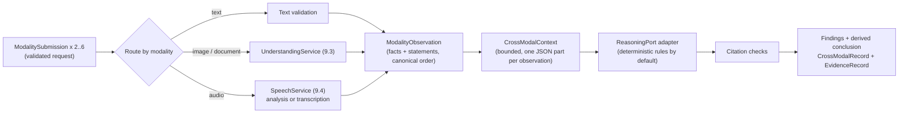

# Module 9 Cross-Modal Reasoning Workflow (Story 9.5)

## What this is

Story 9.5 adds the application-level multimodal workflow. Inputs from at least two modalities are
processed through the accepted Story 9.3 and 9.4 paths, normalized into typed observations,
combined into one bounded reasoning context, and related by a `ReasoningPort` adapter. Every finding
cites the statements and measurements it rests on, and those citations are checked before anything
is recorded. It lives in three places:

| Location | Role |
|---|---|
| `contracts/reasoning.py` | Structured reasoning I/O contract: `ObservationView`, `ObservedFact`, `Statement`, `CrossModalFinding`, `ReasonerOutput` |
| `adapters/reasoning/` | `DeterministicCrossModalReasoner`, a deterministic `ReasoningPort` adapter, with its claim lexicon and rules |
| `crossmodal/` | `CrossModalWorkflow`, observations, bounded context, output validation, conclusion, and `CrossModalRecord` |



## What it is, and is not

| Capability | What actually happens | What it is not |
|---|---|---|
| Modality processing | Unchanged Story 9.3 and 9.4 paths: local pixel analysis, document extraction, PCM WAV measurement, and fixture-playback or test-double transcripts | Not new processing; no OCR, no speech recognition |
| Normalization | Each processed input becomes typed facts (locally measured or extracted) and bounded statements (user text, extracted document text, transcripts), each labeled with its origin | Not interpretation |
| Cross-modal reasoning (default) | Rule-based deterministic reasoning: a closed vocabulary of claims is read from statements and judged against measurements taken from a different input | Not model inference. No language or multimodal model runs, and nothing outside the vocabulary is understood |
| Reasoning test doubles | Tests bind scripted `ReasoningPort` adapters to exercise output validation and failures | Provider-contract evidence only (`automated_test`) |
| Model-based reasoning | Not implemented. `model_inference` is a reserved reasoning kind that every record rejects. Live providers belong to Story 9.8 | |

## Observations

Every successful input becomes one `ModalityObservation`. Its `view` is exactly what the reasoning
port sees; its `provenance` is what reviewers additionally see.

| Modality | Facts (origin) | Statements (origin) | Trust |
|---|---|---|---|
| Text | None | Sentences of the text (`user_provided`) | `untrusted_external` |
| Image | Quadrant colors with shares, dominant colors with shares, brightness, orientation, size (`local_measurement`) | None | `untrusted_model_output` |
| Document | Format, title, section count, word count (`local_extraction`) | Headings and sentences (`local_extraction`) | `untrusted_model_output` |
| Audio | Content (`silent`/`signal`), duration, sample rate, channels, and for signals a tone estimate of half the zero-crossing rate, valid for single tones only (`local_measurement`) | Transcript sentences when transcription was requested (`fixture_playback` or `provider_contract_test_double`) | `untrusted_model_output` |

Contracts enforce these pairings: a fact can only be measured or extracted locally, a text
observation has no facts, statement origins must fit the modality, and `model_inference` is not an
allowed origin. Raw image, document, and audio bytes never enter an observation, and submission
bytes are excluded from serialization.

Observation IDs (`obs-1`, ...) are assigned after processing in a canonical order (modality, then
content-derived input ID), so results do not depend on submission order. Statement and fact IDs
(`obs-1-s2`, `obs-2-f1`) are derived from the observation.

## Bounded context

`build_context` assembles the views and `reasoning_request` builds the accepted `ReasoningRequest`:
the fixed, application-authored `REASONING_TASK`, and one `ReasoningPart` per observation whose
content is that observation's canonical JSON document. Untrusted text therefore stays inside JSON
strings: it cannot end the document, forge a finding, or reach the task.

| Bound | Default | Hard ceiling |
|---|---|---|
| Inputs per run | 6 | 8 |
| Inputs per modality | 2 | 4 |
| Distinct modalities | at least 2 | |
| Aggregate input bytes | 24 MiB | 48 MiB |
| Statements per observation | 24 | 48 |
| Characters per statement | 500 | 1,000 |
| Statement characters per observation | 4,000 | 16,000 |
| Facts per observation | | 32 |
| Context characters | 48,000 | 96,000 |
| Reasoning output characters / chunks | 64,000 / 32 | 128,000 / 64 |
| Findings | 48 | 64 |
| Provider calls per run | one per non-text input plus one reasoning call, within `max_provider_calls_per_session` | |

Truncated observations are marked and listed in the context statistics.

## Deterministic reasoning rules

`DeterministicCrossModalReasoner` (`deterministic-rule-reasoner`) applies a small, fixed set of
rules. It is genuine, reproducible inference across modalities, and it is rule-based.

**Claim vocabulary.** Statements are split into clauses and tokenized. A claim is read only when a
clause uses this closed vocabulary:

| Property | Read from | Example |
|---|---|---|
| `image.region.<quadrant>` | A quadrant phrase (top-left, upper right, ...) paired with a color word | "The top-left quadrant is red." |
| `image.color` | A color word in a clause that names an image (image, picture, photo, ...) | "The picture has no yellow." |
| `image.brightness`, `image.orientation` | dark, bright; square, landscape, portrait, in a clause that names an image | "The photo is bright and portrait." |
| `audio.content` | silent words or tone words in a clause that names audio | "The recording is silent." |
| `audio.duration_ms` | A number with ms or seconds, with a duration or audio cue | "The clip lasts 1.5 seconds." |
| `audio.tone_hz` | A number with Hz or kHz | "a 400 hertz tone" |

A negator up to two words before a value negates it ("isn't red", "no tone"). Everything else,
including instructions, is ignored.

**Rules.**

1. *Verdict*: a claim is judged against facts about the same property from a **different**
   observation. Agreement is `corroborated`, disagreement is `contradicted`. Tolerances: duration
   within 50 ms or 10%, tone within 5%, a color counts as present at 5% of pixels.
2. *Claim pair*: two claims about one property from different observations. A disagreement is
   always a `claim_conflict` and is never resolved arbitrarily; the conflict is still reported when
   a measurement also judges each claim. An agreement is reported only when nothing measures the
   property.
3. *Unverified*: a claim no other observation measures. A transcript cannot corroborate the audio
   it came from, because that is the same input.
4. *Shared concepts*: two observations of different modalities sharing at least two distinctive
   words. This is lexical overlap, not semantic equivalence.

Confidence: verdicts are `high`, except region verdicts where the region color covers less than 60%
(`medium`) and tone verdicts, which rest on a zero-crossing estimate (`medium`). Conflicts are
`medium`; agreements, unverified claims, and shared concepts are `low`.

**Proof that modalities interact.** The tests remove each modality in turn: removing the image turns
a corroborated region claim into an unverified claim; removing the text removes the inference
entirely; swapping a tone for silence flips the same text claim from contradicted to corroborated.

## Output validation and conclusion

Reasoning output is `untrusted_model_output` from any adapter. The workflow collects the chunk
stream under the request timeout, with bounded chunk count and size, exactly one final chunk, and
every chunk attributed to the bound adapter. It parses one `ReasonerOutput` (`extra="forbid"`
throughout) and checks every finding against the context: cited observations, statements, and facts
exist; each quote appears in its statement; a verdict's facts concern the claimed property and come
from a different observation; listed modalities match the observations; shared terms occur in both
observations. One bad citation fails the whole output.

The conclusion is computed by the workflow from validated findings, never accepted from the adapter:
`consistent` (corroborations and no contradiction or conflict), `inconsistent` (contradictions or
conflicts and no corroboration), `mixed` (both), or `unverified` (nothing was judged). It counts each
kind of finding and lists the modalities that cross-modal findings relied on.

## Reviewer-visible record

`CrossModalRecord` serializes to JSON and shows: status (`succeeded`, `partial`, `rejected`,
`failed`); one outcome per submission with its processing record (`UnderstandingRecord`,
`SpeechRecord`, or validated text input) or safe error; the observations with provenance; context
statistics; the reasoning provider and `reasoning_kind`; every finding with its citations,
confidence, and plain explanation; the conclusion; per-stage timings (validation, modality
processing, context construction, reasoning, output validation, end to end); the failed stage and
`SafeError` for unsuccessful runs; and a Story 9.5 `EvidenceRecord` stating what did and did not
happen. `model_inference_performed` and `live_provider_called` are fixed to `False`.

```python
import asyncio

from multimodal_voice_platform.contracts.modality import Modality
from multimodal_voice_platform.contracts.session import SessionConfig
from multimodal_voice_platform.crossmodal import CrossModalWorkflow, ModalitySubmission

workflow = CrossModalWorkflow()
fixture = workflow.catalog
submissions = [
    ModalitySubmission(modality=Modality.TEXT, text="The recording is silent and lasts 2 s."),
    ModalitySubmission(
        modality=Modality.AUDIO,
        media_type="audio/wav",
        display_name="tone.wav",
        data=fixture.content("audio-tone"),
    ),
]
record = asyncio.run(workflow.run(SessionConfig(session_id="demo"), submissions))
print(record.model_dump_json(indent=2))  # two contradicted claims; conclusion "inconsistent"
```

## Failure behavior

| Situation | Result |
|---|---|
| Live session | `rejected`, `live_mode_not_authorized`, before any processing |
| Too many inputs, too many of one modality, aggregate size, provider-call budget | `rejected`, `limit_exceeded`, at validation |
| Fewer than two distinct modalities supplied | `rejected`, `unsupported_modality`, at validation |
| Duplicate content, or an item that is not a submission | `rejected`, `input_rejected`, at validation |
| One input fails its processing path | Recorded on its outcome; the run is `partial` if two modalities remain, otherwise `rejected` at modality processing |
| Context over its bound | `rejected`, `limit_exceeded`, at context construction |
| Adapter raises `ReasoningProviderUnavailableError`, misbehaves, or returns invalid or uncited output | `failed`, `provider_unavailable`, retryable where the provider failed; the payload is never echoed |
| Adapter exceeds the request timeout | `failed`, `provider_timeout`, retryable |
| Configuration defects (reserved reasoning kind, live or non-reasoning adapter, wrong evidence class) and unexpected exceptions | Raised, not recorded |

There are no retries, so there is no retry loop.

## Security

| Control | Behavior |
|---|---|
| Prompt injection | Document, transcript, and text instructions stay statements. Tests show the committed document's instruction and an injected transcript change no session, mode, adapter, or evidence, and forged findings JSON in text never becomes a finding |
| Authority | Mode, budgets, limits, adapters, and the task come only from application code and `SessionConfig`. The reasoning adapter returns content, never authority |
| Output trust | Every finding is citation-checked; the conclusion is derived by the workflow |
| Execution and I/O | AST tests confirm the Story 9.5 code imports no network, process, filesystem, or later-story module and calls no `open`, `eval`, or `exec` |
| Network and keys | Tests run the four-modality workflow with sockets blocked and credential variables removed |
| Retention | Processing services release staged bytes before returning; records carry no raw binary content |

## Dependencies

None added. The workflow, rules, and validation use the Python standard library and the existing
Pydantic contracts. No LLM framework is used.

## Evidence

Story 9.5 evidence is `automated_test`: the suite runs generated images, documents, and audio, the
committed fixtures, and scripted test doubles through the real workflow with sockets blocked and no
credentials. `CrossModalRecord` can emit `deterministic_demo` records for reviewer runs and rejects
every other class; test-double reasoning runs may only be `automated_test`. No `live_integration`
evidence exists.

| Behavior | Evidence it provides |
|---|---|
| Local image, document, and audio processing | Actual local processing evidence (Stories 9.3 and 9.4) |
| Fixture-playback transcript | Deterministic fixture evidence; not speech recognition |
| Rule-based cross-modal inference | Genuine deterministic cross-modal reasoning evidence; not model inference |
| Reasoning test doubles | Provider-contract evidence only |
| External reasoning model | None; would be `live_integration` (Story 9.8) |

## Requirement status

| Requirement | Status | Justification |
|---|---|---|
| SRC-005 Cross-modal reasoning | Partially implemented | Observations from several modalities are combined into one bounded context and related by reproducible, cited rules that demonstrably depend on more than one modality. The rules cover only a closed vocabulary; model-based semantic reasoning needs a live provider (Story 9.8), and reviewer-visible `deterministic_demo` evidence needs Story 9.9 |
| SRC-015 Lab: create multimodal AI workflow | Partially implemented | The application-level workflow exists and is tested end to end with up to four modalities. The required `deterministic_demo` in Streamlit is Story 9.9 |
| ENG-006 Untrusted content never grants authority | Partially implemented | Now enforced and tested on the reasoning context and reasoning output path too. Release acceptance (9.10) remains |
| SRC-001, SRC-018 | Designed | The workflow is a core part of the platform, but the integrated, reviewer-visible platform needs Stories 9.9 and 9.10 |

## Out of scope

Conversation state and voice orchestration (9.6); WebSocket streaming (9.7); live reasoning,
vision, or speech providers and BYOK (9.8); Streamlit (9.9); release (9.10).
