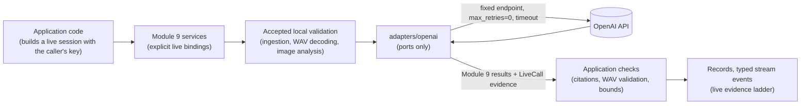

# Module 9 Secure Opt-In Live Providers (Story 9.8)

## Status

**Story 9.8 is complete with accepted `live_integration` evidence for A–E.**
Deterministic SDK/adapter tests remain `automated_test`; separately human-authorized real-provider
execution established vision, speech-to-text, text-to-speech, model reasoning, and provider streaming.
This closeout records human-accepted evidence; it performs no new provider call. Sanitized summaries
are recorded here; original evidence remains outside the repository under `TECHADEMY/EVIDENCE`.

| Capability | Accepted live status |
|---|---|
| A — vision | ESTABLISHED |
| B — speech-to-text | ESTABLISHED |
| C — model reasoning | ESTABLISHED |
| D — text-to-speech | ESTABLISHED |
| E — provider streaming | ESTABLISHED |

Earlier accepted evidence established one live voice turn (STT -> streamed reasoning -> TTS) over
loopback WebSocket. This is bounded integration evidence, not live multi-turn recall, deployment,
reviewer UI, or final production/security acceptance.

### Final C verification

The accepted `final_c_only_live_verification` established C (`C_model_reasoning`): cross-modal
status succeeded, evidence class `live_integration`, real OpenAI endpoint, vision and reasoning
succeeded, reasoning streamed with 237 provider output events. Reasoning model: `gpt-5.4-mini`.
Reasoning usage: 1,405 input, 506 output, 267 reasoning, 1,911 total tokens (reasoning tokens are
part of output). Reasoning latency approximately 3,868.849 ms; first output approximately
2,773.429 ms. Vision latency approximately 3,062.54 ms. These are single-run measurements,
not a production SLO, throughput benchmark, or proof of low-latency completion (SRC-012).
No request IDs, raw provider payloads, credentials, or sensitive live artifacts are copied here.

## What this is

OpenAI is Module 9's first live provider (human decision, Option A), behind the unchanged
provider-neutral ports. Application code depends only on Module 9 contracts.

| Location | Role |
|---|---|
| `contracts/live.py` | Provider-neutral `LiveCall`, `ProviderUsage`, `LiveCapability`, and the live evidence ladder (`live_evidence`, `check_live_evidence`) |
| `live/` | Provider-neutral live core: `LiveProviderConfig`, ephemeral credentials (`live_session`), `LiveBinding`, sanitized errors, redaction, prompts and output schemas, streamed-JSON scanner, the live acceptance runner |
| `adapters/openai/` | Everything OpenAI-specific: client creation, requests, models, response parsing, streaming translation, usage extraction, exception translation |
| Services (`speech/`, `understanding/`, `crossmodal/`, `voice/`, `streaming/`) | Accept explicit live bindings; a live session uses them, a deterministic session never does |



## Selected APIs and models

Chosen from the installed SDK (`openai` 3.31.0), not from memory. Every model is configurable in
`LiveProviderConfig`; no model identifier appears in application logic.

| Capability | API | Default model | Why |
|---|---|---|---|
| Vision | Responses API, `input_image` (base64 data URL, `detail=low`), strict JSON-schema output | `gpt-5.4-mini` | Current multimodal model family in the SDK's model list; small model and low image detail bound cost |
| Multimodal and conversational reasoning | Responses API, `stream=True`, strict JSON-schema output | `gpt-5.4-mini` | Same API supports structured output and server-sent-event streaming of output-text deltas |
| Speech-to-text | `audio.transcriptions` (`response_format=json`) | `gpt-4o-mini-transcribe` | Listed transcription model; returns text and usage |
| Text-to-speech | `audio.speech` (`response_format=pcm`, voice `alloy`) | `gpt-4o-mini-tts` | Listed speech model. Raw PCM (documented as 24 kHz, 16-bit, mono) is wrapped in a WAV header by the adapter and then decoded and validated by the accepted Story 9.4 path; provider media metadata is never trusted alone |

Accepted live verification exercised the supported capabilities. Future model availability is
account-dependent. If a model is unavailable to the account,
the run reports `provider_permission_denied` and the model is changed in configuration.

Document understanding keeps accepted local extraction before reasoning; documents are not
uploaded to the provider.

## Mode selection

- Deterministic mode is the default and unchanged. A deterministic session never reaches a live
  adapter, even when live bindings are configured and an API key exists in the environment.
- Live mode requires an explicit, opted-in live `SessionConfig` (`live_session`) **and** a service
  built with live bindings. A live session sent to a service without live bindings is refused
  (`live_mode_not_authorized`), exactly as before Story 9.8.
- There is no fallback in either direction. A failed live call is a failed live record; it is never
  replaced by deterministic output.
- Importing Module 9 does not import the OpenAI SDK; importing the adapters creates no client.

## Credential lifecycle (ephemeral BYOK)

1. The backend receives the caller's key at the trusted boundary (Story 9.9's UI will collect it in
   a password field; the acceptance runner reads it with a hidden prompt or one named variable).
2. `live_session` checks it locally (length, printable ASCII, no whitespace) and stores it as a
   `SecretStr` in the session configuration, which excludes it from serialization and `repr`.
   Validation failures report a fixed message, never the value.
3. For one operation, a live adapter reads it only to create an `AsyncOpenAI` client inside
   `async with`, passing it explicitly (never via the environment), and closes the client afterward.
4. It is sent only to the provider, in the `Authorization` header (tested).

The key is never written to disk, `.env`, logs, records, events, errors, evidence, URLs, or test
snapshots. WebSocket clients cannot send a key or select live mode: client messages have no such
fields. A live WebSocket session exists only when the server-side coordinator is configured with a
live binding and a server-held credential source.

## Redaction and failure translation

- Provider exceptions are translated inside the adapter into stable application errors with fixed
  messages, and the provider exception is not chained, because SDK messages can echo partial keys
  or request bodies. Non-secret diagnostics (HTTP status, request ID) are kept as attributes.
- `live/redaction.py` removes known secrets and key-shaped tokens from text that leaves the process
  and provides a logging filter; the acceptance runner installs it and checks its evidence file.

| Provider condition | Error code |
|---|---|
| 401 | `provider_authentication_failed` |
| 403, 404 (model or operation not available) | `provider_permission_denied` |
| 429 | `provider_rate_limited` |
| Timeout | `provider_timeout` |
| Connection failure, 5xx, stream `error` or `response.failed` | `provider_unavailable` |
| 400, 422 | `input_rejected` |
| Malformed, incomplete, or invalid output | `provider_unavailable` (output) |
| Refusal | `provider_refused` |
| Call, size, or text budget exceeded | `budget_exhausted` |
| Live selected without a usable credential | `live_mode_not_authorized` |

## Capabilities

| Capability | Design | Untrusted output handling |
|---|---|---|
| Vision | Image passes ingestion and local pixel analysis first; then the live model's description is added as `model_vision`, kept separate from the local measurements | `VisionResult` is untrusted; in the cross-modal workflow it becomes statements labeled `model_inference`, never facts |
| Speech-to-text | Audio passes ingestion and local PCM decoding and measurement; then one final transcript segment | Transcript untrusted; labeled `speech_recognition`; no partial transcripts are produced or claimed |
| Text-to-speech | Text bounded (`max_speech_chars`); PCM wrapped as WAV, then decoded and validated locally | A response that is not 16-bit PCM, or fails local validation, is rejected |
| Reasoning | Bounded, application-assembled context (fixed task, JSON data block marked untrusted) with strict structured output | Every citation, quote, fact ID, and history reference is checked by application code; unknown or invented references reject the output |
| Streaming | Provider output-text deltas are translated in the adapter; for voice turns, each reply act is released as soon as the provider has streamed its closing brace, then citation-checked by the Story 9.7 coordinator and sent as `response_delta` | Raw provider events never leave the adapter; WebSocket clients see only the typed protocol |

Streaming granularity is honest: `response_delta` carries whole reply acts assembled from provider
token deltas, not individual tokens, and each one is observable before the provider response
completes (tested with a fake stream paused mid-response).

## Cost controls

| Control | Value |
|---|---|
| Automatic retries | None (`max_retries=0`); each failure is reported once |
| Provider calls per adapter instance (one operation) | 1 by default, ceiling 4 |
| Per-session provider calls | `ResourceBudget.max_provider_calls_per_session` (voice turns reserve 3 up front) |
| Request timeout / operation deadline | 30 s / 60 s by default (ceilings 60 s / 120 s) |
| Reasoning output tokens | 1,200 by default (includes reasoning tokens) |
| Vision output tokens / image detail / image bytes | 800 / `low` / 2 MiB |
| Speech text | 600 characters by default |
| Audio input | Session byte and duration budgets, checked locally before any call |
| Model fallback | None |

Usage reported by the provider is kept as provider-neutral quantities (`ProviderUsage`: input,
output, reasoning, and total tokens, audio seconds). No dollar cost is estimated or claimed.

## Evidence ladder

| What ran | Evidence class | Execution mode |
|---|---|---|
| A call reached the real provider endpoint | `live_integration` | live |
| Live adapters over a contract test double (mocked transport) | `automated_test` | live |
| Live session rejected before any provider call (only local processing ran) | `deterministic_demo` (reviewer) or `automated_test` (tests) | deterministic |

Every live-mode record is Story 9.8 evidence and lists its `LiveCall`s (capability, model, real
endpoint or not, outcome, failure code, request ID, usage, latency, time to first output). A binding
that claims the real endpoint is checked against its adapter, so a mocked transport can never
produce `live_integration` evidence; a real binding can only be run as `live_integration`. Model
output cannot set any evidence field.

## Tests (no key, no network, no cost)

| File | Covers |
|---|---|
| `tests/test_live_adapters.py` | Real SDK and adapters over the fake API: request construction and bounds, parsing into Module 9 contracts, malformed and refused output, status and transport failure translation, no retries, per-adapter call budget, configuration ceilings, provider stream release before completion, cancellation recording, key confinement |
| `tests/test_live_mode.py` | Mode selection and no fallback, import isolation, credential handling and redaction, evidence ladder, invented citations and fact IDs rejected, model output cannot forge evidence, live streaming through the coordinator and the WebSocket gateway, cancellation, client messages cannot carry a key, acceptance runner refusals |

## Live acceptance procedure (separately authorized)

`live/acceptance.py` is invoked separately, never by pytest:

```bash
uv run python -m multimodal_voice_platform.live.acceptance --confirm-paid-call \
    --out ../../EVIDENCE/module-09-story-9-8-live-acceptance.json
```

It states that real, paid calls will be made, refuses without `--confirm-paid-call`, reads the key
with a hidden prompt (or `--key-env NAME`), and makes six small calls with project-owned content:
live vision on the committed four-quadrant PNG and live streamed reasoning over it and one text claim
(the cross-modal workflow); live text-to-speech of one fixed sentence; and one voice turn over a real
loopback WebSocket whose audio is that sentence (live speech-to-text, live streamed reasoning with
`response_delta` before `response_complete`, live text-to-speech). It writes a redacted evidence
file, refuses to write it if the key appears, and reports which of A (vision), B (speech-to-text),
C (reasoning), D (text-to-speech), and E (provider streaming) were established.

## Requirement status

ENG-002 is implemented: its requirement is explicit opt-in with secure ephemeral user-supplied
credentials; deterministic security checks and accepted live execution satisfy that scope.
SRC-002/005/006/007/009/010 retain partial status because their traceability includes reviewer
acceptance/demonstration; SRC-006 also requires partial transcripts, which are not produced.
SRC-008 remains partial: one live turn does not establish live multi-turn acceptance.
SRC-012 remains partial: measured latency does not establish production performance.
SRC-013 through SRC-018 remain partial pending Story 9.9 and/or 9.10. ENG-001 remains partial
pending the unified no-key reviewer experience. No requirement wording or acceptance criterion is relaxed.

## Accepted validation and provenance boundary

Before final live verification: Ruff passed, pytest 798 passed, compileall passed; deterministic
repair/acceptance made zero provider calls and requested zero API keys. These historical gate
counts are separate from subsequent closeout validation.

Pydantic remains authoritative and fail-closed. Provider lexical constraints mirror application
contracts; citation/provenance validation remains application-owned. For `shared_concepts`, every
shared term must occur literally as a whole word, case-insensitively, in the statement text of
each cited observation; omit the finding if fewer than two qualifying terms exist. The final C
run passed this boundary. No rejected raw payload is published in evidence or errors.

Module 9 is incomplete. Stories 9.9 and 9.10 are not started. Streamlit reviewer UI is not
implemented; Streamlit deployment, deployment verification, final production/security acceptance,
and LinkedIn publication have not occurred. These remain module completion requirements.

## Not in this story

Streamlit (9.9); persistent credential storage; browser-side provider calls; user-controlled
endpoints; deployment, authentication, and TLS (9.10); other providers.
