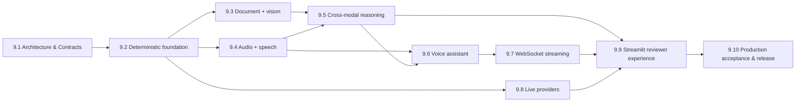

# Module 9 Story Roadmap

Ten stories deliver Module 9. Story 9.1 is complete (design only). Story 9.2 is complete
(deterministic fixture playback only; no genuine inference). Story 9.3 is complete (local image
and document extraction and structural analysis; no model inference). Story 9.4 is complete (local
audio processing; STT and TTS pipelines with fixture-playback STT and tone-sequence TTS; no speech
recognition or synthesis). Story 9.5 is complete (cross-modal workflow with rule-based deterministic
reasoning; not model inference). Story 9.6 is complete (synchronous voice-assistant orchestration
with bounded multi-turn conversation state; fixture-playback STT, rule-based reasoning, and
tone-sequence TTS; no speech recognition, speech synthesis, model inference, or streaming). Story
9.7 is complete (genuine WebSocket gateway and incremental streaming of rule-based reply fragments
on loopback; not model tokens; no authentication or live providers). Story 9.8 is complete (OpenAI live adapters, explicit live mode, ephemeral BYOK; deterministic
contract tests and accepted live integration for vision, STT, TTS, model reasoning, and streaming). Story 9.9 is complete (local reviewer UI, deterministic AppTest and real loopback WebSocket
acceptance); Story 9.10 is complete for local engineering acceptance and ready for independent review.
Module 9 remains incomplete; human-controlled release closeout is pending.

| Story | Title | Scope | Status |
|---|---|---|---|
| 9.1 | Architecture & Contracts | Authoritative requirements; traceability; architecture; ADRs; typed modality, session, provider, and streaming contracts; threat/security model; acceptance and Definition of Done foundation | Complete (design/documentation only) |
| 9.2 | Deterministic Multimodal Foundation | Reproducible text, image, audio, and document fixtures; deterministic provider implementations; no-key execution | Complete (deterministic foundation only; see [DETERMINISTIC_FOUNDATION.md](DETERMINISTIC_FOUNDATION.md)) |
| 9.3 | Document + Vision Understanding | Validated image and document processing; structured understanding | Complete (local extraction and structural analysis only; no model inference; see [UNDERSTANDING.md](UNDERSTANDING.md)) |
| 9.4 | Audio + Speech Pipeline | Audio processing; STT; TTS | Complete (local WAV processing and STT/TTS pipelines; no speech recognition or synthesis; see [AUDIO_SPEECH.md](AUDIO_SPEECH.md)) |
| 9.5 | Cross-Modal Reasoning Workflow | Combine processed modalities into a single reasoning context; genuine multimodal reasoning result | Complete (rule-based deterministic cross-modal reasoning; not model inference; see [CROSS_MODAL.md](CROSS_MODAL.md)) |
| 9.6 | Voice-Enabled AI Assistant | Conversation state; STT -> reasoning -> TTS orchestration | Complete (synchronous voice orchestration and bounded multi-turn state; deterministic STT, reasoning, and TTS; no streaming; see [VOICE_ASSISTANT.md](VOICE_ASSISTANT.md)) |
| 9.7 | Real-Time WebSocket Streaming | Typed streaming protocol; partial/final events; lifecycle handling; error handling; genuine WebSocket execution | Complete (Starlette/Uvicorn WebSocket gateway on loopback; incremental rule-based reply fragments, not model tokens; no `transcript_partial` without genuine partial STT; see [STREAMING.md](STREAMING.md)) |
| 9.8 | Secure Opt-In Live Providers | Ephemeral BYOK configuration; live provider adapters; redaction; budgets; timeouts | Complete: accepted live integration for A–E; see [LIVE_PROVIDERS.md](LIVE_PROVIDERS.md) |
| 9.9 | Unified Streamlit Reviewer Experience | Voice assistant; multimodal workflow; streaming evidence; metrics and evidence presentation; concise built-in guidance on how reviewers use and test the workflows and what results demonstrate | Complete (local reviewer UI; ready for independent review; see [REVIEWER_UI.md](REVIEWER_UI.md)) |
| 9.10 | Production Acceptance & Release | Security and failure tests; observability; documentation; deployment/release evidence; production-grade acceptance | Complete for local engineering acceptance; ready for independent review; see [RELEASE_READINESS.md](RELEASE_READINESS.md). Deployment/publication remain pending |

## Story dependencies

## Story rules

- Each story stays inside `module-09/**`.
- Each story implements only its own scope and updates traceability, evidence, and status docs.
- No story claims a later story's capability because its architecture is documented.
