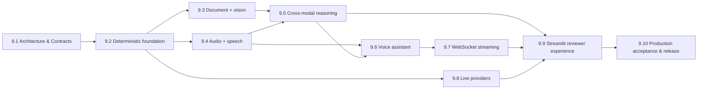

# Module 9 Story Roadmap

Ten stories deliver Module 9. Story 9.1 is complete (design only). Story 9.2 is complete
(deterministic fixture playback only; no genuine inference). Stories 9.3 to 9.10 are not started.

| Story | Title | Scope | Status |
|---|---|---|---|
| 9.1 | Architecture & Contracts | Authoritative requirements; traceability; architecture; ADRs; typed modality, session, provider, and streaming contracts; threat/security model; acceptance and Definition of Done foundation | Complete (design/documentation only) |
| 9.2 | Deterministic Multimodal Foundation | Reproducible text, image, audio, and document fixtures; deterministic provider implementations; no-key execution | Complete (deterministic foundation only; see [DETERMINISTIC_FOUNDATION.md](DETERMINISTIC_FOUNDATION.md)) |
| 9.3 | Document + Vision Understanding | Validated image and document processing; structured understanding | Not started |
| 9.4 | Audio + Speech Pipeline | Audio processing; STT; TTS | Not started |
| 9.5 | Cross-Modal Reasoning Workflow | Combine processed modalities into a single reasoning context; genuine multimodal reasoning result | Not started |
| 9.6 | Voice-Enabled AI Assistant | Conversation state; STT -> reasoning -> TTS orchestration | Not started |
| 9.7 | Real-Time WebSocket Streaming | Typed streaming protocol; partial/final events; lifecycle handling; error handling; genuine WebSocket execution | Not started |
| 9.8 | Secure Opt-In Live Providers | Ephemeral BYOK configuration; live provider adapters; redaction; budgets; timeouts | Not started |
| 9.9 | Unified Streamlit Reviewer Experience | Voice assistant; multimodal workflow; streaming evidence; metrics and evidence presentation; concise built-in guidance on how reviewers use and test the workflows and what results demonstrate | Not started |
| 9.10 | Production Acceptance & Release | Security and failure tests; observability; documentation; deployment/release evidence; production-grade acceptance | Not started |

## Story dependencies

## Story rules

- Each story stays inside `module-09/**`.
- Each story implements only its own scope and updates traceability, evidence, and status docs.
- No story claims a later story's capability because its architecture is documented.
