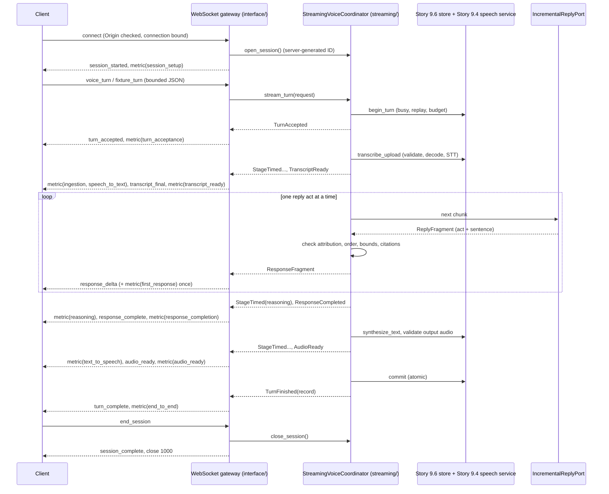

# Module 9 Real-Time WebSocket Streaming (Story 9.7)

## What this is

Story 9.7 adds a genuine WebSocket boundary and an incremental streaming protocol for voice turns.
A client connects, the server opens a conversation for that connection, and each voice turn streams
typed events as the pipeline produces them: the turn's acceptance, the final transcript, each reply
fragment while reasoning is still running, the completed reply, the validated output audio, the
turn's outcome, and latency metrics. It lives in four places:

| Location | Role |
|---|---|
| `contracts/streaming.py` | Typed protocol (version 1): eleven server events, three client messages, strict parsers with size bounds |
| `contracts/conversation.py` | `ReplyFragment` and `IncrementalReplyPort`: a voice reply produced one act at a time |
| `streaming/` | `StreamingVoiceCoordinator` (application core): runs the Story 9.6 turn stage by stage and yields typed updates; `StreamingLimits`; `StreamedTurnRecord` |
| `interface/` | Starlette WebSocket gateway (`create_app`) and the Uvicorn loopback server (`build_server`, `python -m multimodal_voice_platform.interface`) |



## What it is, and is not

| Capability | What actually happens | What it is not |
|---|---|---|
| WebSocket transport | A real ASGI WebSocket application (Starlette) hosted by Uvicorn with the sans-I/O `websockets` protocol; loopback tests connect an independent RFC 6455 client over an OS TCP socket | Not authenticated, not TLS, not deployed: loopback only. Deployment is Story 9.10 |
| Incremental response streaming | Each reply act is generated, validated, and sent before the next act is computed. A test holds the reasoner after its first fragment and observes the `response_delta` at the client while the reply does not exist and nothing is committed | Not model tokens: fragments are whole rule-based reply acts. Not a finished reply split into chunks |
| Reasoning (default) | The Story 9.6 rule-based conversation reasoner, made lazy: statements are read one at a time as the consumer asks for the next fragment | Not model inference |
| Transcript events | `transcript_final` is sent once the transcript is validated, before reasoning starts | No `transcript_partial` is sent: fixture-playback STT is not speech recognition and produces no live partial transcript, so emitting one would be fabricated |
| Audio events | `audio_ready` is sent after the generated audio is decoded and validated, with its reference, digest, size, and duration | Not speech synthesis (tone sequence), not streamed audio; the bytes are not sent over the socket in Story 9.7 |
| Latency metrics | Local wall-clock measurements per stage and per milestone, including time to first streamed response | Not an SLA and not production or provider latency |
| Live providers | Not implemented. Sessions are deterministic; Story 9.8 owns live providers | |
| Reviewer UI | Not implemented. Story 9.9 consumes these events and records | |

Requirement status is conservative: SRC-011 (WebSockets) is implemented; SRC-008, SRC-010, SRC-012,
SRC-016, and ENG-008 are partially implemented (see [Requirement status](#requirement-status)).

## Protocol

Every event is JSON with `protocol_version` 1, `type`, `session_id`, a per-connection `sequence`
that starts at 0 and increases by one, and `turn_id` on every turn-scoped event. Events are at most
64 KiB; the server refuses to send a larger one.

| Event | When | Payload |
|---|---|---|
| `session_started` | After the handshake | `mode` (always `deterministic`) |
| `turn_accepted` | The turn passed admission (session idle, turn ID not replayed, within bounds) | none |
| `transcript_final` | The transcript passed validation | `text` (untrusted data) |
| `response_delta` | One validated reply fragment | `index`, `text` |
| `response_complete` | Every fragment arrived and the assembled reply passed validation | `finish_reason`, `delta_count` |
| `audio_ready` | Output audio passed validation | `audio_ref`, `media_type`, `duration_ms`, `audio_sha256`, `size_bytes` |
| `metric` | A stage finished, or a milestone was reached | `stage`, `duration_ms`, `measure` (`stage`, `since_turn_received`, `since_connect`) |
| `error` | A safe failure | `error` (`code`, `message`, `retryable`) |
| `turn_complete` | The turn ended | `status` (`committed`, `rejected`, `failed`, `cancelled`), `committed`, `conversation_sequence`, `failed_stage`, `delta_count`, `evidence_class`, `execution_mode`, `stt_processing`, `reasoning_processing`, `tts_processing` |
| `session_complete` | The session ended and the connection is closing | `reason` |
| `transcript_partial` | Defined by Story 9.1; never sent in Story 9.7 (no truthful producer) | `text` |

Client messages are JSON text frames of at most `max_inbound_message_bytes` (512 KiB by default):

| Message | Fields |
|---|---|
| `voice_turn` | `turn_id`, `media_type`, `display_name`, `audio_base64` (canonical base64, decoded size at most `max_audio_bytes`, 256 KiB by default), optional `language` |
| `fixture_turn` | `turn_id`, `fixture_id` (a committed audio fixture), optional `language` |
| `end_session` | none |

A client message has no `session_id`, `mode`, budget, provider, trust, authority, or evidence field.
Any field outside its model is a protocol error, so forged metadata cannot be smuggled in.

### Turn event order

A committed turn always sends, in this order (with `metric` events between them):
`turn_accepted`, `transcript_final`, one or more `response_delta`, `response_complete`,
`audio_ready`, `turn_complete`. A turn that fails sends `error` and then `turn_complete` with the
failed stage and `delta_count`, so reply text streamed before a later failure (for example a
text-to-speech failure) is never hidden: the client knows it received partial output that was not
committed. A turn rejected at admission sends no `turn_accepted`.

### Session lifecycle

| Event | Server behavior | Close code |
|---|---|---|
| Browser `Origin` not on the allowlist (empty by default) | Handshake refused before the session opens | 1008 (HTTP 403 on a socket) |
| Connection or session bound reached | Handshake refused | 1013 |
| `end_session` | Running turn cancelled, session closed, `session_complete(completed)` | 1000 |
| No message for `idle_timeout_s` while no turn runs | Session closed, `session_complete(timeout)` | 1000 |
| Message over `max_inbound_message_bytes` | `error`, then `session_complete(error)` | 1009 |
| `max_protocol_errors` malformed messages | `error` each time, then `session_complete(error)` | 1008 |
| A send does not complete within `send_timeout_s` | Turn cancelled, session closed | 1008 |
| Unexpected server failure | Logged server-side; client gets a fixed `internal_error`, then `session_complete(error)` | 1011 |
| Client disconnects | Running turn cancelled, session closed; nothing more is sent | none |

One session per connection; the session ID is generated by the server and is correlation, not
identity. There is no resumption: a session cannot be reattached from another connection, and its
history is released when the connection ends.

## Genuine incremental streaming

The coordinator does not run the Story 9.6 turn and then split its reply. It drives the stages
itself through the same components and yields as each stage produces something:

1. `IncrementalReplyPort.stream_reply` yields one `ReasoningChunk` per `ReplyFragment` and then one
   empty final chunk. The deterministic adapter's `iter_reply` is a generator: it reads the next
   statement only when the consumer asks for the next fragment, so a fragment exists before any
   later statement is examined. `answer` (the Story 9.6 document) is built from the same generator,
   so both paths say exactly the same thing.
2. The coordinator pulls one chunk at a time under the request deadline (time spent waiting on the
   adapter counts; time spent delivering to the client does not), checks attribution, order, count,
   and size, parses the fragment, checks its citations with the Story 9.6 `validate_reply`, checks
   the running reply length, and yields it.
3. The gateway sends it as `response_delta` immediately, awaiting the send. The coordinator is
   suspended until the send completes, which is natural backpressure: nothing is queued.

Executable evidence:

| Test | What it proves |
|---|---|
| `test_fragment_is_observable_while_reasoning_is_still_running` | With the reasoner held after fragment 0, the consumer has the fragment while the reasoner has produced exactly one fragment, no response is complete, and nothing is committed |
| `test_response_delta_reaches_the_client_before_the_reply_exists` | Same, end to end through the gateway: the client holds a `response_delta`, no further event arrives for 200 ms, then the rest streams after the gate opens |
| `test_deterministic_adapter_yields_each_fragment_before_reading_later_statements` | The real adapter examines statement 2 only after fragment 0 is consumed |
| `test_real_socket_uploaded_audio_and_disconnect_mid_turn` | Over a real loopback socket, the client receives `response_delta` while the reasoner is still held |

## Bounds and backpressure

| Bound | Default | Ceiling |
|---|---|---|
| Client message | 512 KiB | 4 MiB |
| Decoded audio per turn | 256 KiB | 2 MiB (base64 must fit in one message) |
| Reply fragments per turn | 8 | 8 (`MAX_REPLY_ACTS`) |
| Events per turn | 64 | 256 |
| Protocol errors per session | 3 | 16 |
| Send timeout | 5 s | 30 s |
| Idle timeout | 120 s | 900 s |
| Turn timeout | 60 s | 120 s |
| Concurrent connections | 16 | 256 (and the assistant's active-session bound) |
| Protocol frame size (Uvicorn) | message bound + 4 KiB | |
| Inbound frame queue (Uvicorn) | 8 frames | |

Per connection there are at most two tasks (receive and the running turn); both are cancelled and
awaited when the connection ends. There is no event queue: each event is sent before the next is
produced. Per-message compression is off. Reasoning output, history, reply length, provider calls,
and session lifetime keep their Story 9.6 bounds.

## Disconnect, cancellation, and state

The Story 9.6 transaction semantics hold for streamed turns, because both use the same
`ConversationStore`: admission marks the session busy and reserves provider calls; history changes
only at the atomic commit after every stage succeeded; `release` clears the busy mark in a
`finally` block.

- Disconnect, turn timeout, event-bound breach, slow client, or `end_session` mid-turn cancels the
  turn task. Cancellation reaches the reasoning adapter (its stream is closed in the coordinator's
  `finally`), the busy mark is released, nothing is committed, and the turn ID stays unused.
- At the service level, closing or cancelling a turn generator leaves the session usable: a later
  turn, even with the same turn ID, commits normally.
- A failure after deltas were streamed is reported as a failed or rejected turn with its
  `delta_count`; history is unchanged.
- A replayed turn ID is rejected at admission; a second turn while one runs is rejected by the
  gateway (and, at the service level, by the store's busy check); sessions on different
  connections are isolated.

## Latency evidence

The gateway sends `metric` events measured with a monotonic clock:

| Metric | Measure | Meaning |
|---|---|---|
| `session_setup` | `since_connect` | Handshake received to `session_started` sent |
| `turn_acceptance` | `since_turn_received` | Turn message received to `turn_accepted` sent |
| `ingestion`, `speech_to_text`, `reasoning`, `text_to_speech` | `stage` | Stage durations measured by the coordinator; `reasoning` counts time spent waiting on the adapter only |
| `transcript_ready` | `since_turn_received` | To `transcript_final` sent |
| `first_response` | `since_turn_received` | To the first `response_delta` sent: time to first streamed response |
| `response_completion` | `since_turn_received` | To `response_complete` sent |
| `audio_ready` | `since_turn_received` | To `audio_ready` sent |
| `end_to_end` | `since_turn_received` | To `turn_complete` sent |

Tests check that every value is finite and non-negative, that milestone values are non-decreasing in
send order, and that `first_response` precedes `response_complete`. `StreamedTurnRecord` keeps the
coordinator's own milestones (`time_to_first_response_ms`) for Story 9.9. These are local
measurements of deterministic in-process adapters on one machine. They establish that latency is
measured per stage and that the first response is observable before completion; they do not
establish low latency for real speech or model providers, so SRC-012 stays partially implemented.

## Security

| Threat | Control | Test |
|---|---|---|
| Malformed JSON, unknown types, server-only event types, binary frames | Strict client-message union; safe `protocol_error`; session ends after repeated errors | `test_malformed_unknown_and_server_only_messages_get_safe_protocol_errors`, `test_binary_frames_are_rejected`, `test_repeated_protocol_errors_end_the_session` |
| Forged session, mode, evidence, provider, trust, authority, or sequence fields | `extra="forbid"`; session bound to the connection by the server | `test_forged_metadata_is_rejected_and_never_runs_a_turn` |
| Oversized messages, oversized or non-canonical audio, malformed audio | Size checked before parsing; strict base64 with a decoded bound; Story 9.4 audio validation | `test_oversized_message_is_refused_before_parsing_and_closes`, `test_oversized_and_malformed_audio_are_rejected_per_turn`, `test_real_socket_refuses_foreign_origin_and_oversized_frames` |
| Cross-site WebSocket hijacking | Exact-origin allowlist, empty by default | `test_origin_policy_refuses_unlisted_browser_origins` |
| Connection flood | Connection bound; per-connection task bound | `test_connection_bound_refuses_extra_clients` |
| Replay, duplicate, concurrent turns; session confusion | Store admission; one turn per connection; server-generated session IDs | `test_replayed_turn_and_concurrent_turn_are_rejected`, `test_connections_are_separate_sessions` |
| Prompt injection in the transcript | Transcript is data; no field it can reach changes configuration | `test_injection_like_transcript_is_streamed_as_inert_data` |
| Secret or exception leakage | Only `SafeError` crosses the boundary; unexpected failures are logged and replaced by a fixed message | `test_unexpected_failure_is_sanitized_logged_and_ends_the_session`, `test_audio_payload_is_never_echoed` |
| Network or provider calls in deterministic mode | Loopback-only server; socket guard in loopback tests; deterministic adapters only | `test_server_binds_loopback_only`, loopback tests' `loopback_only` guard |

There is no authentication: `allow_missing_origin` admits non-browser clients that send no
`Origin`, and the origin allowlist is not authentication. Deployment (Story 9.10) must put the
gateway behind TLS and authentication before exposing it beyond loopback.

## Dependency decision

The source requires genuine WebSockets, and Module 9 had no ASGI or WebSocket dependency. Story 9.7
adds the smallest mature stack that provides a real WebSocket boundary without hand-written framing:

| Package | Why | Where |
|---|---|---|
| `starlette` | Lightweight ASGI toolkit with a typed WebSocket API (handshake, receive, send, close) | `interface/websocket.py` only |
| `uvicorn` | Production-capable ASGI server that hosts the gateway | `interface/server.py` only |
| `websockets` | RFC 6455 implementation Uvicorn uses for framing; the independent client in loopback tests | Uvicorn protocol layer and tests only |

No LLM, agent, or HTTP client framework is added. Governance tests restrict each import to its
module.

## Evidence classification

| Behavior | Evidence class |
|---|---|
| In-process ASGI WebSocket tests (`test_websocket_gateway.py`) | `automated_test`: real application, real ASGI interface, no socket |
| Loopback Uvicorn server and `websockets` client (`test_websocket_loopback.py`) | `automated_test` that is genuine local socket-level WebSocket integration; not external and not `live_integration` |
| Coordinator tests (`test_streaming_coordinator.py`) | `automated_test` |
| Reviewer runs through `python -m multimodal_voice_platform.interface` | `deterministic_demo` records (the server's default) |
| External provider streaming | None; would be `live_integration` (Story 9.8) |

Streamed `VoiceTurnRecord`s set `streaming_performed` and carry Story 9.7 evidence; the record
validator refuses a streamed record labeled Story 9.6 and the reverse. Speech recognition, speech
synthesis, model inference, and live-provider flags stay `False`.

## Requirement status

| Requirement | Status | Justification |
|---|---|---|
| SRC-011 WebSockets | Implemented | Genuine WebSocket server and client exchange typed events over an OS socket on loopback, with lifecycle, bounds, and failure handling tested |
| SRC-010 Streaming responses | Partially implemented | Reply fragments are produced and delivered incrementally before the reply exists. They are rule-based reply acts, not model tokens; no model or live-provider output is streamed |
| SRC-008 Real-time conversations | Partially implemented | Multi-turn conversations run over a real-time WebSocket session. There is no speech recognition, live provider, or reviewer UI |
| SRC-012 Low-latency pipelines | Partially implemented | Stage and milestone latency, including time to first response, is measured and streamed. Local deterministic timings do not establish low latency for real providers |
| SRC-016 Lab: real-time streaming system | Partially implemented | The streaming system exists and is tested; the reviewer-visible `deterministic_demo` is Story 9.9 |
| ENG-008 Observability without secrets | Partially implemented | Typed latency metrics and safe errors; unexpected failures logged server-side only. Structured observability across the module is Story 9.10 |
| ENG-006, ENG-007 | Partially implemented (extended) | Client content grants no authority; transport, payload, event, timeout, and connection bounds |

## Running it

```bash
uv run python -m multimodal_voice_platform.interface
# ws://127.0.0.1:8765/ws/voice, deterministic adapters, no key, no network beyond loopback
```

Then, with any WebSocket client, send
`{"type": "fixture_turn", "turn_id": "turn-1", "fixture_id": "voice-remember"}`, then
`{"type": "fixture_turn", "turn_id": "turn-2", "fixture_id": "voice-recall"}`, then
`{"type": "end_session"}`.

## Not in this story

Live STT, reasoning, or TTS providers and model token streaming (9.8); Streamlit (9.9);
authentication, TLS, and deployment (9.10). `transcript_partial` stays unsent until a speech-to-text
adapter produces genuine partial transcripts.
