# Module 9 Voice-Enabled AI Assistant (Story 9.6)

## What this is

Story 9.6 adds the application-level voice assistant. `VoiceAssistant` owns bounded, multi-turn
conversations and runs one complete, synchronous voice turn per call by coordinating the accepted
Story 9.4 speech pipeline, the Story 9.5 observation and reasoning boundary, and the provider
ports. It does not duplicate any of them. Every turn returns a typed `VoiceTurnRecord`. It lives in
three places:

| Location | Role |
|---|---|
| `contracts/conversation.py` | Structured reply contract carried over the unchanged `ReasoningPort`: `AssistantReply`, `ReplyAct`, `ReplyActKind` |
| `adapters/reasoning/conversation.py` | `DeterministicConversationReasoner`, a rule-based `ReasoningPort` adapter that reads the current transcript and the bounded history |
| `voice/` | `VoiceAssistant` orchestrator, `ConversationStore` state, reply validation, limits, committed conversation fixtures, and `VoiceTurnRecord` |

```mermaid
flowchart LR
    REQ["VoiceTurnRequest<br/>(session ID, turn ID, audio)"] --> ADM["Admission<br/>(active, idle, unreplayed, in budget)"]
    ADM --> SPC["SpeechService.transcribe_upload (9.4)<br/>audio validation, PCM decoding, STT port"]
    SPC --> TV["Transcript validation<br/>(untrusted, bounded)"]
    TV --> CTX["observe_speech (9.5) as one JSON part<br/>+ bounded history window from state"]
    CTX --> RSN["ReasoningPort adapter<br/>(conversation rules by default)"]
    RSN --> RV["Reply parsing + citation checks"]
    RV --> TTS["SpeechService.synthesize_text (9.4)<br/>TTS port, generated-audio validation"]
    TTS --> COMMIT["Atomic state commit"]
    COMMIT --> OUT["VoiceTurnRecord + EvidenceRecord"]
```

## What it is, and is not

| Capability | What actually happens | What it is not |
|---|---|---|
| Voice orchestration | Genuine application-level orchestration of every stage through the accepted ports, with typed results, stage timings, and transaction semantics | Not streaming; not a WebSocket session (Story 9.7) |
| Audio processing | Unchanged Story 9.4 path: signature checks, strict RIFF/WAVE parsing, PCM decoding, and signal measurement | |
| Speech-to-text (default) | Fixture playback: a scripted transcript replayed when the audio's digest matches a committed fixture | Not speech recognition |
| Conversation state | Genuine, bounded, application-owned multi-turn state that later turns depend on | Not persistence: state is in memory and released when the session closes |
| Reasoning (default) | Rule-based deterministic reasoning over two fixed phrasings (`remember ... is ...`, `what is ...?`) and the bounded history | Not model inference. No language model runs, and nothing outside the two phrasings is understood |
| Text-to-speech (default) | Deterministic tone-sequence audio rendered from the reply text, then decoded and validated locally | Not speech synthesis: the audio is not intelligible speech |
| Test doubles | Tests bind scripted STT, reasoning, and TTS adapters to exercise failures and arbitrary conversations | Provider-contract evidence only (`automated_test`) |
| Live speech or reasoning | Not implemented. Live sessions are refused; Story 9.8 owns live providers | |

## Turn stages

| Stage | Component | Fails with |
|---|---|---|
| `admission` | `ConversationStore.begin_turn` | Unknown or closed session, expired session, busy session, replayed turn ID, turn limit, provider-call budget |
| `audio_validation` | Story 9.4 ingestion | Unsupported, mismatched, oversized, or malformed audio; unsafe file name |
| `audio_processing` | Story 9.4 PCM decoding and measurement | Malformed audio; processing timeout |
| `speech_to_text` | `SpeechToTextPort` via Story 9.4 | Provider unavailable, timeout, or invalid transcript stream; fixture playback of non-fixture audio |
| `transcript_validation` | Voice core | Empty, oversized, or control-character transcript |
| `context_construction` | Story 9.5 `observe_speech` and `render_view`; history window from state | Context over its limits |
| `reasoning` | `ReasoningPort` via the Story 9.5 bounded collector | Provider unavailable, timeout, misattributed or excess chunks, no final chunk |
| `reply_validation` | `voice.reply` | Invalid reply document, failed citation, reply over its length limit |
| `text_to_speech` | `TextToSpeechPort` via Story 9.4 | Reply text unsafe for synthesis; provider unavailable or timeout |
| `output_audio_validation` | Story 9.4 generated-audio validation | Missing, malformed, or misreported generated audio |
| `state_commit` | `ConversationStore.commit` | Session closed or changed while the turn ran |

Every stage has a measured duration in `timings`, followed by one `end_to_end` measurement.
`latency_metrics()` maps them onto the contract's `LatencyStage` names (`ingestion`,
`speech_to_text`, `reasoning`, `text_to_speech`, `end_to_end`) for later reviewer and streaming
use. These are local wall-clock measurements of deterministic adapters. They are not production
latency and support no SLA claim.

## Conversation state and bounds

`ConversationStore` keeps one in-memory conversation per active session. Application code opens a
conversation with a `SessionConfig`, which is bound to it and is the only source of mode and budget
authority for its turns. A `VoiceTurnRequest` names a session ID, a turn ID, and the audio. It has
no mode, budget, provider, trust, history, or evidence field, and extra fields are rejected.

| Bound | Default | Hard ceiling |
|---|---|---|
| Retained exchanges (user turn plus reply) | 6 | 25 |
| Retained characters | 12,000 | 64,000 |
| Exchanges in one reasoning context | 4 (and at most `max_history_turns / 2`) | 25 |
| Characters in one reasoning context | 6,000 | 64,000 |
| Committed turns per session | 50 | 200 |
| Active sessions per assistant | 16 | 256 |
| Transcript characters per turn | 2,000 | 4,000 |
| Reply characters | 600 | 1,000 |
| Reasoning output | 8 chunks, 16,000 characters | 16 chunks, 32,000 characters |
| Provider calls per turn | 3, reserved against `max_provider_calls_per_session` | |
| Session lifetime | `session_timeout_s` | 30 minutes |

Retention evicts the oldest whole exchanges first. The reasoning context is the newest whole
exchanges that fit, in chronological order. Committed exchanges hold text only; no input or
generated audio is retained. Closing or expiring a session releases its history.

## Transaction semantics

1. Admission marks the session busy and reserves the turn's three provider calls.
2. Every stage from audio validation to output-audio validation runs without touching history.
3. The state commit appends the transcript and the reply as one exchange in one step, only if the
   session is still active, still running this turn, and unchanged since admission.
4. The busy mark is cleared whether the turn commits, fails, or raises.

A turn that fails at any stage before the commit leaves the conversation exactly as it was. A turn
that fails at the commit (for example because the session was closed mid-turn) has generated audio
in its record but is not committed and is reported as `failed`. Reserved provider calls are never
refunded, so failures cannot be retried for free. There are no automatic retries.

Replay: a turn ID that was committed in the session is rejected at admission without re-running
any stage. A turn ID whose turn failed was never committed, so the caller may retry it. A second
turn that arrives while one is running is rejected as busy; the first is unaffected.

A session ID is correlation identity, not authentication. Anyone holding an active session ID can
submit turns to it; transport identity belongs to Stories 9.7 and 9.9. A turn cannot create a
session.

## Deterministic conversation reasoning

`DeterministicConversationReasoner` reads the current turn's observation (the transcript as
statements, plus local audio measurements) and `ReasoningRequest.history`. It understands exactly
two phrasings, case-insensitive over ASCII words, with at most three name words and one value:

| Phrasing | Act | Reply |
|---|---|---|
| `remember [that] [the\|my\|our] <name> is <value>` | `remembered` | "Noted: the `<name>` is `<value>`." |
| `what is\|was [the\|my\|our] <name>?`, with an earlier user turn that asked to remember `<name>` | `recalled` | "Earlier in this conversation you said the `<name>` is `<value>`." |
| The same question with no such earlier user turn | `not_recalled` | "No earlier turn in this conversation tells me the `<name>`." |
| Anything else | `heard` | Repeats up to 200 characters of what was heard and describes the two phrasings |

Recall reads earlier *user* turns only, newest first, so an assistant reply can never become a
source of facts. A turn cannot recall what it states itself. At most eight acts and 1,000
characters are produced. `request.task` does not change the rules.

## Reply validation

Every reply is `untrusted_model_output`. Before it is spoken or committed, `voice.reply` checks:
the document matches `AssistantReply` (extra fields such as `grant` are rejected); every act cites
a statement of the current turn and quotes it exactly; a named item appears in its quote; a
recalled value cites a user turn inside the exact history window the reasoning call received, that
turn contains the history quote, the quote states the name and value, and the reply text says the
value. One bad citation rejects the whole reply. The reply text is then validated again as text
input by the Story 9.4 synthesis path.

## Multi-turn proof

The committed conversation fixtures (`voice-remember`, `voice-recall`, `voice-injection`) are
1-second generated tones with scripted transcripts. Tests prove that state matters:

- In one session, asking for the project code word, then stating it, then asking again yields
  `not_recalled`, `remembered`, then `recalled` with the value `falcon` and a citation of the
  earlier user turn.
- The identical recall audio and transcript in a fresh session yields `not_recalled`, a different
  reply, and different output audio.
- Evicting the earlier exchange (small retention) or narrowing the context window makes the same
  question unanswerable.
- The newest earlier value wins, sessions are isolated, and the same conversation is reproducible.

## Reviewer-visible record

`VoiceTurnRecord` carries everything Story 9.9 needs without moving logic into Streamlit: session
and turn IDs; status and whether the turn committed; the embedded Story 9.4 transcription record
(input audio metadata and measurements, the transcript and its processing kind); the transcript
view and its trust; the conversation context (history exchanges and characters sent, retained
exchanges, bounds); the reasoning provider and kind; the validated reply and its cited acts; the
embedded Story 9.4 synthesis record (generated audio digest, size, and duration; the bytes are held
in memory for playback and excluded from serialization); the conversation snapshot; stage and
end-to-end timings; the failed stage and safe error; and the evidence record.
`speech_recognition_performed`, `speech_synthesis_performed`, `model_inference_performed`,
`live_provider_called`, and `streaming_performed` are always `False`.

## Security

| Concern | Control |
|---|---|
| Injection-like transcripts | Statements inside one JSON-encoded part beside a fixed task; the committed `voice-injection` fixture and scripted injections are tested as inert data |
| History granting authority | History is untrusted turns; recalling "the execution mode is live" is only spoken text and changes nothing |
| Provider output granting authority | Replies are text to speak; extra fields are rejected; citations are checked |
| Forged state, provider, or evidence metadata | Not request fields; the session configuration is bound by application code |
| Replay, concurrency, stale state | Committed turn IDs rejected; one running turn per session; commit requires an unchanged session |
| Excessive history or payloads | Retention, context, transcript, reply, output, turn, session, and provider-call bounds |
| Malformed generated audio | Story 9.4 generated-audio validation before the turn can commit |
| Secrets | No credential is accepted; live sessions are refused; records and state are tested free of secrets and raw audio |
| Network, processes, files | Voice code imports no network, process, or filesystem module; socket-blocked conversation test |

## Dependencies

None added. The orchestrator, state, rules, and validation use the Python standard library and the
existing Pydantic contracts. No agent or LLM framework is used. Story 9.5's private reasoning
collector was made public as `collect_reasoning_output` so both workflows share one bounded,
attributed reasoning call.

## Evidence

Story 9.6 evidence is `automated_test`: the suite runs the committed conversation fixtures,
generated audio, and scripted test doubles through the real orchestrator with sockets blocked and
no credentials. `VoiceTurnRecord` can emit `deterministic_demo` records for reviewer runs and
rejects every other class; turns with any test-double provider may only be `automated_test`. No
`live_integration` evidence exists.

| Behavior | Evidence it provides |
|---|---|
| Voice orchestration and transaction semantics | Genuine application-level orchestration evidence |
| Multi-turn conversation state | Genuine bounded state evidence; later turns demonstrably depend on it |
| Local audio decoding and generated-audio validation | Actual local audio processing (Story 9.4) |
| Fixture-playback transcript | Deterministic fixture evidence; not speech recognition |
| Rule-based conversation reasoning | Deterministic rule-based reasoning; not model inference |
| Tone-sequence output audio | Deterministic audio generation; not speech synthesis |
| Stage timings | Local measurements; not production latency |
| Live speech or reasoning | None; would be `live_integration` (Story 9.8) |

## Requirement status

| Requirement | Status | Justification |
|---|---|---|
| SRC-009 Voice orchestration | Partially implemented | The audio -> STT -> reasoning -> TTS turn is genuinely orchestrated with typed results and tested end to end. It runs only with fixture-playback STT, rule-based reasoning, and tone TTS; orchestrating genuine speech recognition, model reasoning, and speech synthesis needs live providers (Story 9.8, now listed for SRC-009) |
| SRC-008 Real-time conversations | Partially implemented | Multi-turn conversations with bounded session state work and later turns depend on earlier ones. Turns are synchronous; real-time streaming over a WebSocket is Story 9.7 |
| SRC-013 Voice interaction systems | Partially implemented | The application-level interaction system (sessions, turns, spoken replies) exists. A user cannot yet speak to it: there is no UI (Story 9.9) and no speech recognition (Story 9.8) |
| SRC-014 Lab: build voice-enabled assistant | Partially implemented | The assistant is built and tested. The required `deterministic_demo` in Streamlit is Story 9.9 |
| SRC-017 Deliverable: voice-enabled AI assistant | Partially implemented | The deliverable's application core exists. Production acceptance evidence needs Stories 9.9 and 9.10 |
| ENG-007 Bounded cost and latency | Partially implemented | Conversation history, context, turns, sessions, reply size, reasoning output, and provider calls per session are enforced at runtime with no retries. Live-provider budgets (9.8) and release acceptance (9.10) remain |
| ENG-006 Untrusted content never grants authority | Partially implemented | Now enforced and tested on transcripts, conversation history, and replies too. Release acceptance (9.10) remains |
| SRC-010, SRC-011, SRC-012, SRC-016 | Designed | Nothing is streamed and no latency claim is made; Stories 9.7 and 9.10 |

## Out of scope

WebSocket server or gateway, streaming protocol execution, partial-transcript or response-delta
events (9.7); live STT, reasoning, or TTS providers and BYOK (9.8); Streamlit (9.9); release (9.10).
No response is split into chunks to imitate streaming.
